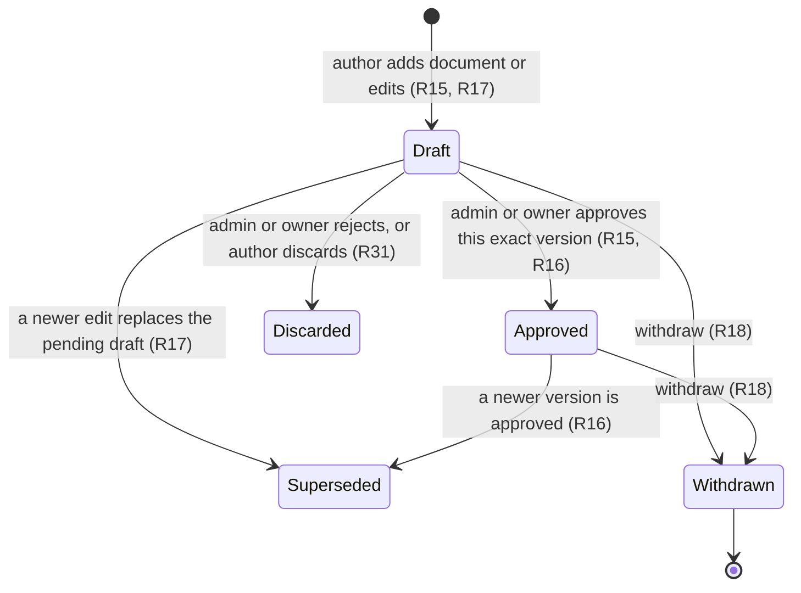
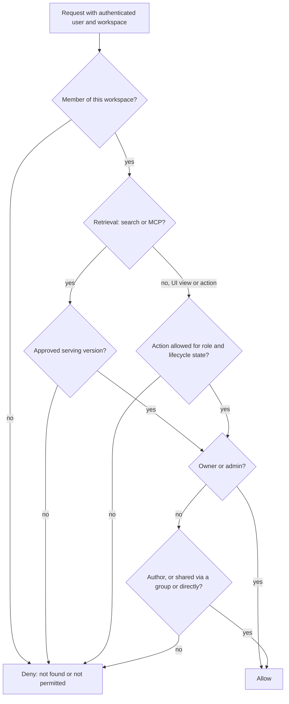
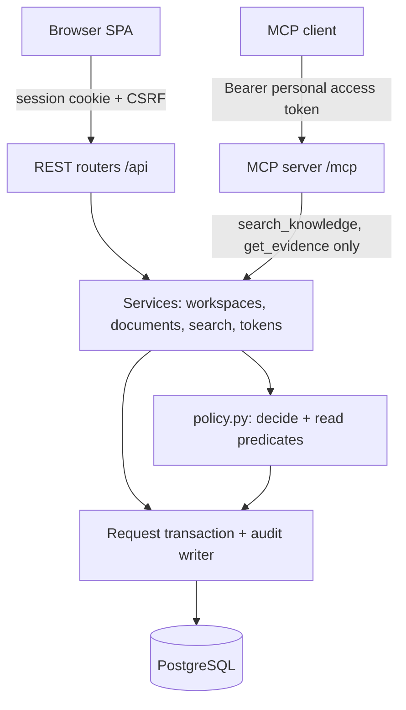
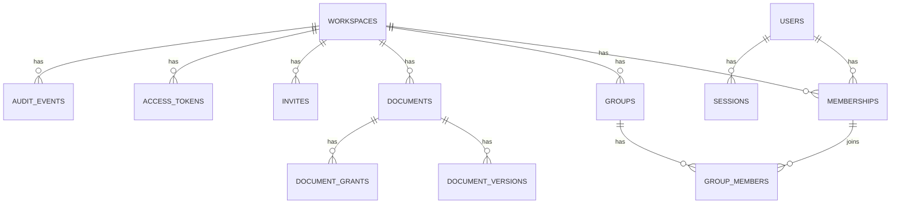

# Workspace Authorization and Policy Kernel - Plan

## Goal Capsule

- **Objective:** In every Lattice workspace, each person and each agent can see and do only what their role and document access allow. The answer is the same in the web UI, in search, and through MCP, every decision can be explained afterwards, and the model grows into a multi-team product without a rewrite.
- **Means:** One application-owned policy, applied in two forms: a decision for a single action or item, and a filter applied inside every search query.
- **Product authority:** The decisions in this plan, plus the governance design principles in `governed-knowledge-store-thoughts.md` (lines 75–85).
- **Open blockers:** None.
- **Stop conditions:** Stop and report if a settled Key Decision proves infeasible, if the policy decision and search filter cannot be made to agree (R26), or if the audit trail cannot be made fail-closed (R34).
- **Execution profile:** Greenfield; built test-first around the policy kernel (U3), identity (U4) and the audit transaction (U5), then outward to management flows, search, MCP and the UI.
- **Finishing:** Implemented, reviewed and shipped as one pull request by the `lfg` pipeline; merging stays with the repository owner.

---

## Product Contract

### Summary

Lattice gets workspace-scoped roles (owner, admin, member), group-based document access, and a draft → approved → withdrawn lifecycle where admins approve.
A single policy decides every action and every search result, for people in the UI and for agents over MCP, and records each decision with its reason.
Invitations, groups, sharing, approval and access tokens ship as real flows behind a deliberately plain UI.

### Problem Frame

Lattice's value rests on one promise: agents only use organisational knowledge they are allowed to use.
No authorization model exists yet; the repo holds only the proposal, a README and a licence.
The proposal names the principles (same logic for UI and MCP, identity from authentication, permission changes affecting the next retrieval), but not who holds which powers or how documents become visible.
A filter built only for the demo would have to be rewritten before Lattice could serve more than one team, and agents would multiply the cost of any gap, because an agent retrieves at machine speed under a person's identity.

### Actors

- A1. Owner — the person who created the workspace. Exactly one per workspace.
- A2. Admin — manages members, groups, sharing and approval.
- A3. Member — adds documents and uses the knowledge they can access.
- A4. Agent — an MCP client connected with a member's, admin's or owner's personal access token. It acts as that user.
- A5. Invitee — a person holding an invite link who has not joined yet.

### Key Decisions

- **Workspaces are tenants from day one.** User accounts are global and everything else belongs to exactly one workspace. Governs R1, R2, R3. (session-settled: user-approved — chosen over one workspace per deployment: avoids a migration that touches every table and query when Lattice goes multi-team.)
- **Document access comes from groups.** Grants are stored as subject → document, where the subject is a group or a single user; only group sharing has a UI in v1. Governs R11, R12, R13. (session-settled: user-approved — chosen over per-user sharing only, folders/spaces, or both groups and users in the UI: groups stay manageable as the workspace grows, and the subject shape keeps individual sharing open.)
- **Owners and admins can read all document content.** Governs R9. (session-settled: user-directed — chosen over separating "manage" from "read": simpler administration, accepting that admin and owner agents can retrieve every approved document.)
- **An agent acts as the user who connected it.** Governs R22, R23. (session-settled: user-directed — chosen over separate agent accounts and over capped delegation: simplest model, matching how most MCP integrations work today.)
- **Admins approve; members submit drafts.** Governs R15, R16. (session-settled: user-directed — chosen over authors publishing their own documents, after seeing that self-publishing plus admin read-all plus agent inheritance would let any member place unreviewed content in every admin agent's context.)
- **MCP is retrieval-only.** Governs R33. (session-settled: user-approved — chosen over letting agents also submit drafts, and over MCP mirroring every UI action: a prompt-injected admin agent cannot approve content it planted, so the approval gate stays human.)
- **Retrieval returns approved versions only, for every role.** Governs R19. (session-settled: user-approved — chosen over letting authors or admins retrieve drafts: one rule no agent can get around, and withdrawn content never reaches an agent.)
- **Authors share only with groups they belong to; admins share with any group.** Governs R12. (session-settled: user-directed — chosen over authors sharing with any group: stops members pushing content into teams they are not part of.)
- **One application-owned policy, applied as a decision and as a search filter.** Governs R25, R26, R27. (session-settled: user-approved — chosen over database row-level security as the primary enforcer and over an external relationship-based authorization service: explainable decisions with no extra infrastructure; grant storage stays compatible with either later.)
- **Approval does not require a second person.** Admins and the owner can approve their own drafts. Governs R15.
- **New documents start unshared.** A forgotten sharing step fails closed. Governs R11.

### Requirements

**Workspaces and membership**

- R1. A person signs up once and can belong to any number of workspaces, with one role per workspace.
- R2. Every document, version, group, grant, access token and audit record belongs to exactly one workspace.
- R3. Nothing in one workspace is visible or actionable from another, whatever role the person holds elsewhere.
- R4. Creating a workspace makes its creator the owner, and each workspace always has exactly one owner.

**Roles and management powers**

- R5. Admins and the owner invite people by generating an invite link with a role; admins may invite members only, and the owner may invite members or admins.
- R6. An invite link is single-use, expires, and can be revoked while pending by its inviter, admins or the owner; it stops working if its inviter loses the authority to issue that role, and accepting it while signed in adds that account to the workspace with the stated role.
- R7. Admins and the owner remove members; only the owner promotes, demotes or removes admins.
- R8. Only the owner transfers ownership (the previous owner becomes an admin), and the owner cannot leave without transferring ownership first.
- R9. Owners and admins can open and read any document in their workspace, in any lifecycle state.
- R10. Admins and the owner create, rename and delete groups and manage group membership; deleting a group removes every grant to it.
- R32. Admins and the owner can reassign a document's authorship to another member, so documents of people who leave remain editable.

**Groups and sharing**

- R11. A new document starts unshared, readable only by its author, admins and the owner; sharing makes it readable by others only once a version is approved (R13).
- R12. An author can share their document only with groups they currently belong to and can unshare it from any group; admins and the owner can share or unshare any document with any group.
- R13. A member can read documents they authored, and approved documents shared with a group they belong to or with them directly.
- R14. Removing a person from a group removes the access that group gave them; shares already made to the group stay in place.

**Document lifecycle**

- R15. Every new document or new version starts as a draft, whoever adds it, and only an admin or the owner can approve it.
- R16. Approval names one specific draft version and is refused if that version is no longer the document's pending draft; an approved version becomes the serving version, and the previously approved version stops being served.
- R17. Authors edit only their own documents, and a version's content never changes once created: every edit creates a new draft version that replaces any pending draft, while the approved version keeps serving.
- R18. An author can withdraw their own document and admins and the owner can withdraw any document; withdrawal stops all versions being served and is final in v1.
- R35. The approval screen shows a draft against the currently serving version, so reviewers see what changed.
- R31. An admin or the owner can reject a pending draft and its author can discard it; a rejected or discarded draft is never served, and the approved version keeps serving.

**Retrieval and agents**

- R19. Search in the UI and every MCP retrieval tool return only approved, serving versions that the requesting user may read under R9, R11 and R13.
- R20. Drafts are visible in the UI only to their author, admins and the owner; withdrawn documents remain visible in the UI as history to their author, admins and the owner.
- R21. Search applies the policy inside the query, so permitted results are never displaced or reduced in number by results the user cannot see.
- R22. A user creates, names and revokes personal access tokens for one workspace, and an agent connects to MCP with one of those tokens.
- R23. An MCP request acts with exactly the access of the token's user in the token's workspace; any user, group or role values supplied in the request are ignored.
- R24. A revoked token, or a token whose user has left the workspace, is refused on its next use.
- R33. MCP exposes retrieval only (search and evidence lookup); every management, sharing, lifecycle and token action is available only in the UI to a signed-in person, whatever the token user's role.

**Policy decisions and audit**

- R25. Every action and every retrieval in the UI, the API and MCP is authorized by one policy that is evaluated afresh on each request; nothing caches permissions.
- R26. The policy's single-item decision and its search filter always agree on what a user may read.
- R27. Each single-item decision carries its outcome, the rule that decided it, and the policy inputs it used.
- R28. Every single-item decision (allowed or denied), every search (with the versions it returned) and every change to membership, roles, groups, sharing, authorship, lifecycle or tokens is recorded in the workspace audit trail, with the user, the channel (UI or MCP, including which token), the action, the document version and the time.
- R29. A denied request tells the caller only that the item was not found or is not permitted; the deciding rule is visible to admins and the owner in the audit trail.
- R30. Admins and the owner can view and filter the workspace audit trail in the UI.
- R34. A request whose audit record cannot be written is refused, so the audit trail is complete by construction.

#### Role capabilities at a glance

Each row restates the rule owned by the cited requirement.

| Action | Owner | Admin | Member | Rule |
|---|---|---|---|---|
| Read any document, any state, in UI | Yes | Yes | Own documents, plus approved documents shared with them | R9, R11, R13, R20 |
| Retrieve via search or MCP | Approved only | Approved only | Approved and shared, or own | R19 |
| Add documents and edit own | Yes | Yes | Yes | R15, R17 |
| Approve or reject drafts | Yes | Yes | No; authors discard their own drafts | R15, R31 |
| Withdraw | Any | Any | Own | R18 |
| Share with groups | Any group | Any group | Groups they belong to | R12 |
| Manage groups and group membership | Yes | Yes | No | R10 |
| Reassign document authorship | Yes | Yes | No | R32 |
| Invite | Members or admins | Members | No | R5 |
| Remove people | Anyone except owner | Members | No | R7 |
| Promote, demote, remove admins | Yes | No | No | R7 |
| Transfer ownership | Yes | No | No | R8 |
| Personal access tokens | Own | Own | Own | R22 |
| Any non-retrieval action through MCP | No | No | No | R33 |
| View audit trail | Yes | Yes | No | R30 |

#### Document lifecycle



Only the Approved state is ever returned by search or MCP (R19).

#### Order of policy checks



The prose in R3, R9, R11–R13, R19 and R20 is authoritative; the chart shows the order of read-access checks. Write actions follow the role capabilities table above.

### Key Flows

- F1. Create a workspace
  - **Trigger:** A signed-in person creates a workspace.
  - **Actors:** A1
  - **Steps:** The person names the workspace and becomes its owner; the workspace starts with no groups or documents.
  - **Covered by:** R1, R4
- F2. Invite and join
  - **Trigger:** An admin or the owner invites someone.
  - **Actors:** A1, A2, A5
  - **Steps:** The inviter picks a role and copies the generated link; the invitee opens it, signs in or signs up, and joins with that role.
  - **Covered by:** R5, R6, R28
- F3. Organise groups
  - **Trigger:** An admin sets up teams.
  - **Actors:** A1, A2
  - **Steps:** The admin creates groups and adds or removes members; changes apply on the next request.
  - **Covered by:** R10, R14, R25
- F4. Add and share a document
  - **Trigger:** A member adds a document.
  - **Actors:** A3
  - **Steps:** The document is created as an unshared draft; the author shares it with groups they belong to.
  - **Covered by:** R11, R12, R15
- F5. Approve
  - **Trigger:** A draft is waiting.
  - **Actors:** A1, A2
  - **Steps:** An admin opens the draft and reviews it. Approving makes it the serving version and the previous approved version stops serving; rejecting leaves the approved version serving.
  - **Covered by:** R15, R16, R28, R31
- F6. Connect an agent and retrieve
  - **Trigger:** A user wants their agent to use Lattice.
  - **Actors:** A3 (or A1, A2), A4
  - **Steps:** The user creates a personal access token for the workspace and configures their MCP client with it; the agent searches and receives only approved versions that user may read; each search is audited with the token.
  - **Covered by:** R19, R21, R22, R23, R28
- F7. Withdraw or revoke
  - **Trigger:** A document is wrong, or access must end.
  - **Actors:** A1, A2, A3
  - **Steps:** Withdrawing a document, unsharing it, removing a person from a group or the workspace, demoting an admin or revoking a token takes effect on the very next request in every channel.
  - **Covered by:** R7, R12, R14, R18, R24, R25

### Acceptance Examples

- AE1. **Covers R9, R19.** **Given** an approved document shared with no group, **when** an admin's agent searches for its content, **then** it is returned.
- AE2. **Covers R15, R19, R20.** **Given** a member's draft that matches a query, **when** any user (including an admin) searches via UI or MCP, **then** the draft is not returned; the author and admins can still open it in the UI.
- AE3. **Covers R16, R17, R19.** **Given** approved version 1 and draft version 2 of the same document, **when** a permitted user searches, **then** only version 1 is returned; **after** an admin approves version 2, only version 2 is returned.
- AE4. **Covers R12.** **Given** a member who is not in group `contractors`, **when** they try to share their document with `contractors`, **then** it is refused; an admin can make the same share.
- AE5. **Covers R14, R25.** **Given** a member who reads a document only through group `platform`, **when** an admin removes them from `platform`, **then** their next search, in the UI or via their agent, no longer returns it; documents they authored remain visible to them.
- AE6. **Covers R3, R23.** **Given** a user who is an admin in workspace B and a member in workspace A, **when** their agent uses a token for workspace A, **then** it sees only what that member may read in A and nothing from B.
- AE7. **Covers R23, R29.** **Given** an MCP request that includes a `group` or `user_id` value naming a privileged group, **when** it is evaluated, **then** the values are ignored and the result matches the token user's own access.
- AE8. **Covers R7, R9, R25.** **Given** an admin whose agent can retrieve every approved document, **when** the owner demotes them to member, **then** their agent's next search returns only approved documents they author or that are shared with them.
- AE9. **Covers R18, R28.** **Given** an approved document an agent retrieved yesterday, **when** its author withdraws it, **then** no channel returns it from the next request onwards, and the audit trail still shows yesterday's retrieval.
- AE10. **Covers R21.** **Given** a query whose ten best matches are all documents the user cannot read, **when** the user searches, **then** they still receive up to the requested number of results from documents they can read.

- AE11. **Covers R33.** **Given** an owner's or admin's token, **when** their agent tries to approve a draft, share a document or invite someone through MCP, **then** no MCP tool allows it; those actions succeed only in the UI.

### Success Criteria

- A property-based test generates combinations of roles, group memberships, grants, lifecycle states and channels, and shows that the single-item decision and the search filter agree on every one (R26).
- The same user gets the same set of retrievable documents through UI search and through MCP for every scenario in the test suite (R19, R23).
- Every authorization rule can be located in one place in the codebase, so a reviewer can answer "where is authorization decided?" with one file reference (R25).
- Every acceptance example above runs as an automated test.

### Scope Boundaries

**Deferred for later**

- Separate agent identities, and agents with less access than their user.
- Agents adding or editing content through MCP (R33 keeps MCP retrieval-only).
- Approval as a grantable permission, two-person approval, and a review queue beyond a simple drafts list.
- A UI for sharing with individual users (the data model supports it, per R13).
- Folders or spaces, nested groups, and custom roles.
- Restoring a withdrawn document, hard deletion of documents, and deleting a workspace.
- Email delivery of invites, single sign-on, and admin-revoked tokens for other users.
- Database row-level security as a second safety net, and an external authorization service.
- Explaining denials to the denied user beyond "not found or not permitted".
- Recall reporting of who already received a withdrawn version (ideation idea I4), which builds on the audit trail from R28.

**Outside this plan**

- Retrieval quality, ingestion, citations and the evaluation harness, except where R19, R21 and R28 constrain them.

### Dependencies / Assumptions

- Revocation and withdrawal stop future access only; content already delivered to an external agent cannot be recalled (proposal line 85).
- The proposal's stack (FastAPI, React + TypeScript, LlamaIndex, PostgreSQL + pgvector, MCP SDK) is assumed; it is listed there as a starting recommendation, not a final decision (proposal lines 91–101).
- Approval shows the raw stored text (KTD11), so markup comments are visible to the reviewer; characters that render invisibly even in raw text (for example zero-width characters) can still pass review, a known v1 limitation.
- Admin read-all combined with agent inheritance means an admin's agent can retrieve every approved document; approval (R15) is the only gate on what reaches it, and this is an accepted trade-off.

### Sources / Research

- `governed-knowledge-store-thoughts.md` lines 67 (lifecycle and access group), 75–85 (governance design principles), 91–101 (proposed stack), 163–169 (open decisions).
- MCP 2025-11-25 authorization specification: https://modelcontextprotocol.io/specification/2025-11-25/basic/authorization
- OWASP RAG Security Cheat Sheet (retrieval-time checks, identity-aware retrieval logs): https://cheatsheetseries.owasp.org/cheatsheets/RAG_Security_Cheat_Sheet.html
- PostgreSQL row-level security (bypass by owners and `BYPASSRLS` roles, relevant if the deferred backstop is added): https://www.postgresql.org/docs/17/ddl-rowsecurity.html
- Azure AI Search document-level access (permissions copied into an index go stale until resync, the failure R25 avoids): https://learn.microsoft.com/en-us/azure/search/search-document-level-access-overview
- MCP Python SDK v2 authorization and ASGI mounting (token verifier, mount after routes, lifespan, in-memory client skips HTTP auth; shapes KTD6 and U9): https://py.sdk.modelcontextprotocol.io/run/authorization/ and https://py.sdk.modelcontextprotocol.io/run/asgi/
- Hypothesis stateful testing (model-vs-real invariants after every step; shapes KTD3): https://hypothesis.readthedocs.io/en/latest/stateful.html
- OWASP CSRF Prevention and Forgot Password cheat sheets (synchronizer tokens; single-use expiring bearer links; shape KTD5 and KTD7): https://cheatsheetseries.owasp.org/cheatsheets/Cross-Site_Request_Forgery_Prevention_Cheat_Sheet.html and https://cheatsheetseries.owasp.org/cheatsheets/Forgot_Password_Cheat_Sheet.html
- PostgreSQL privileges and trigger behaviour (append-only runtime role; shapes KTD8): https://www.postgresql.org/docs/current/ddl-priv.html
- Versions observed October 2026: FastAPI 0.143, MCP Python SDK 2.3 (`mcp>=2.3,<3`), SQLAlchemy 2.0, Alembic 1.20, React 19.3, Vite 8.3, React Router 8.4, Testcontainers 2.0.

**Product Contract preservation:** restructured, no scope change: the policy-checks chart caption now scopes the chart to read access, the hidden-content assumption reflects KTD11, and the planning-deferred Outstanding Questions are resolved by KTD5, KTD6, KTD7, KTD8 and KTD10.

---

## Planning Contract

### Key Technical Decisions

- KTD1. **Stack: FastAPI + async SQLAlchemy 2 (psycopg 3) + Alembic on PostgreSQL 18, a React 19 + TypeScript + Vite SPA, and the MCP Python SDK v2.** The backend uses `uv`; dependencies are constrained to the major versions in Sources and locked by `uv.lock` and `package-lock.json`. Python is pinned to 3.13 through `.python-version`, `requires-python` and the Compose and CI images, because wheels for psycopg, pydantic-core and argon2 on the host's 3.15 are unverified. Async was chosen over sync SQLAlchemy because the MCP tools and FastAPI handlers are async and share one service layer. LlamaIndex and pgvector are not needed until vector retrieval lands, so they are not added now.
- KTD2. **One policy module, `backend/app/policy.py`, owns every authorization rule.** It exposes a pure decision function for a subject, action and resource state that returns outcome, rule id and inputs (R27), and a SQL clause builder for the two read predicates, *retrieve* (R19) and *view in UI* (R20). Every service calls it; no route or query encodes a rule itself. Instantiates the Key Decision "One application-owned policy" and governs R25, R26, R27. (session-settled: user-approved — chosen over database row-level security as the primary enforcer and over an external relationship-based authorization service: explainable decisions with no extra infrastructure.)
- KTD3. **R26 is proven per read predicate against an independent oracle.** A Hypothesis `RuleBasedStateMachine` drives real services against real PostgreSQL and, after every step, compares the SQL result ids for *retrieve* and *view* with a plain-Python reference model that shares no code with `policy.py`. Unit tests cover the write-action matrix table-driven from the role capabilities table. Example-only tests were rejected because they cover the combinations someone thought of, and R26 is the claim reviewers will probe. Each Hypothesis example creates its own workspaces and uniquely named users and the invariants consider only those workspaces, so nothing is truncated and the fixture stays on the runtime role; the property suite is marked `property`, runs with `deadline=None`, a small local profile and a larger CI profile.
- KTD4. **Document content is immutable per version.** `document_versions` holds title and body; a document points at its serving version and at most one pending draft and carries a withdrawn timestamp. Approval is a conditional update that succeeds only if the named version is still the pending draft (R16, R17). Every agent-visible field lives on the version, so nothing reaches retrieval unreviewed. Each lifecycle transition is one `UPDATE documents` guarded by the expected pointers and `withdrawn_at IS NULL`, with its row count checked, so the document row is the single serialization point. A mutable row plus a history table was rejected because approval must name content that can never change afterwards.
- KTD5. **Browser and agent credentials never cross.** The browser uses a server-side opaque session cookie (`HttpOnly`, `SameSite=Lax`, `Secure` outside local development) plus a synchronizer CSRF token and an Origin check on unsafe methods. Personal access tokens are accepted only as `Authorization: Bearer` on `/mcp`; REST routes reject bearer credentials and `/mcp` ignores cookies. This closes the path where an admin's token could call management routes and bypass R33. One credential type with scopes was rejected because a scope bug would reopen that path. Sessions also have an absolute lifetime of 7 days, and creating a personal access token requires re-entering the password, so a hijacked session cannot quietly mint a long-lived credential.
- KTD6. **MCP uses the SDK's token-verifier hook with Lattice personal access tokens, labelled a demo adapter.** The verifier looks up the token on every request and returns only trusted claims (user, workspace, token id) after checking it is unrevoked, unexpired and its user is still a member (R23, R24). This is bearer-header compatible but not MCP 2025-11-25 OAuth-profile interoperable; the README says so, and an OAuth authorization server is deferred. The tool set is closed: `search_knowledge` and `get_evidence` (R33).
- KTD7. **Secrets are high-entropy and stored only as keyed verifiers.** Session ids, personal access tokens and invite links are 256-bit CSPRNG values stored as HMAC-SHA-256 under a server pepper with a non-secret lookup prefix, shown once and never logged. Passwords use Argon2id. A fast keyed hash is safe here because these values are random, unlike passwords. Invite tokens travel in the URL fragment and are redeemed by POST, and the accept page sends `Referrer-Policy: no-referrer`. Defaults: tokens expire after 90 days, member invites after 7 days, admin invites after 24 hours, sessions after 12 hours idle; all are configuration values.
- KTD8. **Audit is transactional and append-only to the runtime database role.** Each request runs in one transaction: decide, act or query, insert the audit row, commit, and only then respond (R28, R34). Migrations run as an owner role; the app connects as a role with `INSERT, SELECT` on `audit_events` only, and a trigger rejects `UPDATE`, `DELETE` and `TRUNCATE`. Roles are created by a bootstrap script outside Alembic; the runtime role is not a member of the owner role, holds no `TRIGGER` privilege, and default privileges grant it nothing on future tables. A denial commits its audit row and then returns the generic response (R29). Fail-closed audit means an audit outage is a retrieval outage, which R34 accepts. The README claims "append-only to the application", not tamper-proof against a database superuser.
- KTD9. **Search is one SQL statement.** PostgreSQL full-text search runs over a stored generated `tsvector` on version title and body with a GIN index. Workspace, retrieve-predicate and text match all sit in the `WHERE` clause before `ORDER BY rank LIMIT`, and counts and snippets come only from returned rows (R21). `limit` is capped at 20. Filtering after ranking was rejected because it violates R21 (AE10), and a vector index is deferred with vector retrieval. Snippets use plain-text markers, never HTML.
- KTD10. **People sign in with email and password; there is no password reset in v1** because email delivery is deferred. Sign-up is open; any signed-in person can create a workspace.
- KTD11. **Every user-supplied string renders as text, never as HTML or Markdown.** That covers document bodies, titles, group names, token names, rejection reasons, search queries and audit details; raw-HTML rendering is banned by lint. The approval screen shows a line diff of raw text against the serving version (R35) and makes invisible format characters (Unicode category Cf, such as zero-width spaces) visible as escapes. Sanitized Markdown was rejected because a sanitizer bug would hand member content an admin session.
- KTD12. **Same origin everywhere.** In development the Vite dev server proxies `/api` and `/mcp` to FastAPI; in Compose the backend serves the built SPA. No credentialed CORS is configured.
- KTD13. **Browser and MCP responses carry hardening headers.** A strict Content-Security-Policy without inline scripts, `frame-ancestors 'none'`, `X-Content-Type-Options: nosniff`, and `Secure` cookies on by default with an explicit development opt-out. Unsafe requests with a missing or foreign Origin are refused. `/mcp` validates Host and Origin through the SDK's transport security settings.
- KTD14. **Authorization and the action share one transaction; an in-flight request completes under the authorization it loaded.** The request transaction loads the actor's membership and decides before acting, so a change committed by another request applies from the next request (R24, R25), and the in-flight action is audited. Row locking to serialize role changes against in-flight actions was considered and not built: no requirement asks for it, and the races that corrupt data (double approval, two owners) are already closed by KTD4's guarded updates and the one-owner index.

### Assumptions

Defaults adopted without a user decision because this plan was produced in pipeline mode; each is cheap to change.

- Removing someone from the workspace deletes their group memberships and revokes their tokens; authorship and their pending drafts stay, so re-inviting them never restores old group access. Demoting an admin changes only their role; their tokens keep working at their live access (AE8).
- An existing member who opens an invite link is refused and the link stays valid; roles change only through R7 and R8.
- Ownership can be transferred only to a current admin, atomically and without an acceptance step.
- Rejecting a draft takes an optional reason that the author sees on their document list.
- Members see the names of the groups they belong to, and an author also sees the names of every group their own document is shared with, including groups they have left; only admins and the owner see full member and group rosters.
- Requests that address a workspace the caller is not a member of return the generic not-found response (R29) and are written to the application log, not to that workspace's audit trail, so outsiders cannot flood it.
- Invite creation, revocation, acceptance and rejected use, and workspace creation are audited alongside the R28 events; sign-up and sign-in are global to the user and go to the application log, not to a workspace audit trail.
- `get_evidence` accepts only the serving version id of a retrievable document; every other id returns the same not-found response.
- Arguments an agent sends beyond a tool's declared parameters are dropped and recorded in the audit row as an attempted override (AE7).
- Searching from the UI returns approved versions only (R19); drafts are found through the drafts list, by title.
- Group names are unique per workspace, case-insensitively.
- Direct user grants have no creation API; they are created only in tests so the policy branch stays verified.
- MCP results label each item as retrieved data, not instructions, and include its approver and approval time.
- Approval audit rows record whether the approver was also the author.
- Sign-up and sign-in give the same response shape for known and unknown emails.
- Stored search queries and attempted-override values are truncated to 256 characters.

### High-Level Technical Design

Both channels reach the same services, and every service reaches the database only through the policy and the audit transaction.



A retrieval through MCP shows the fail-closed ordering KTD8 requires:

```mermaid
sequenceDiagram
  participant C as MCP client
  participant V as Token verifier
  participant S as Search service
  participant DB as PostgreSQL
  C->>V: tools/call search_knowledge + Bearer token
  V->>DB: look up token, check revoked, expiry, membership
  V-->>S: trusted claims (user, workspace, token id)
  S->>DB: BEGIN; one SELECT with workspace, retrieve predicate, text match, LIMIT
  S->>DB: INSERT audit row (returned version ids, rule inputs, token id)
  S->>DB: COMMIT
  S-->>C: results only after commit; any audit failure returns an error
```

The data model keeps every tenant row tied to its workspace:



### Output Structure

```text
backend/
  pyproject.toml
  alembic.ini
  app/
    main.py            # FastAPI app, lifespan, routers, MCP mount, static SPA
    config.py
    db.py              # engine, request transaction dependency
    models.py
    security.py        # secret generation, verifiers, password hashing
    auth.py            # session, CSRF, principal loading
    policy.py          # every authorization rule (KTD2)
    audit.py
    services/          # workspaces.py, documents.py, search.py, tokens.py
    routers/           # auth, workspaces, groups, documents, search, tokens, audit
    mcp_server.py
    seed.py
    migrations/
  tests/
frontend/
  package.json
  vite.config.ts
  src/
db/init/01-roles.sql   # owner and runtime database roles (KTD8)
compose.yaml
.github/workflows/ci.yml
README.md
```

### Sequencing

U1 and U2 lay the ground, and U1 ends with an MCP spike; U3 is the policy core; U4 adds identity and U5 the audited request transaction every later unit calls; U6 and U7 build the management flows; U8 and U9 build retrieval; U12 proves equivalence across the finished services; U10 builds the UI; U11 packages the demo.

Build order inside U10 puts the demo path first (sign-in, documents, approval, search, tokens), then members, groups and the audit view, so a slipped week still leaves a working demo.

### Risks & Dependencies

| Risk | Decision |
|---|---|
| MCP Python SDK v2 is young and its auth hooks may change | U1 spikes a mounted `/mcp` with a static verifier and a real client call; the exact version is locked; if v2 fails the spike, fall back to the last stable v1 line and re-check KTD6 |
| Some MCP clients only accept OAuth and ignore a static bearer header | KTD6 labels the adapter; U11 names the clients tested and those not supported |
| Package wheels for Python 3.15 | Pinned to 3.13 (KTD1) |
| Property tests against real PostgreSQL are slow | Separate marker and profiles (KTD3); the CI job runs them in parallel with the rest |
| Fail-closed audit couples availability to audit writes | Accepted by R34; audit inserts are small and in the same transaction |
| Audit table grows without bound | Considered, not built: retention and partitioning; revisit when the table passes a few million rows or before any shared deployment |
| No sign-in or token throttling, and Argon2 on public endpoints | Considered, not built for a locally run demo; required before any public deployment |
| A stolen member token stays valid until revoked, expired, or its user is removed | Accepted for v1; re-authentication to mint tokens (KTD5) limits how one is obtained |
| One server pepper with no rotation procedure | Accepted for v1; rotation would invalidate all sessions and tokens |
| A one-week build across twelve units | Demo-path-first order in U10 and seed data early in U11 |


---

## Implementation Units

### U1. Project scaffold and local environment

- **Goal:** A runnable empty backend and frontend, PostgreSQL in Compose, and CI that runs the test suites.
- **Requirements:** Supports all; no requirement on its own.
- **Dependencies:** None.
- **Files:** `backend/pyproject.toml`, `backend/.python-version`, `backend/app/main.py`, `backend/app/config.py`, `backend/app/db.py`, `db/init/01-roles.sql`, `backend/tests/test_mcp_spike.py`, `frontend/package.json`, `frontend/vite.config.ts`, `frontend/src/main.tsx`, `compose.yaml`, `.github/workflows/ci.yml`, `.gitignore`, `backend/tests/conftest.py`, `backend/tests/test_health.py`
- **Approach:**
  1. Create the backend with `uv`, FastAPI, async SQLAlchemy with psycopg, Alembic, pytest, Hypothesis and Testcontainers (KTD1).
  2. Create the Vite `react-ts` app with `react-router` and the dev proxy for `/api` and `/mcp` (KTD12).
  3. Compose runs PostgreSQL 18 with a health check and an init script that creates the owner and runtime roles (KTD8), plus the backend.
  4. The test fixture starts one PostgreSQL container per session, migrates it as the owner role and hands tests a runtime-role connection.
  5. CI runs backend tests and the frontend build and tests.
  6. Spike: mount a stub `/mcp` with a verifier that accepts one static test token, and call it from the SDK's Streamable HTTP client.
- **Execution note:** Mostly scaffolding; prove it with a health-check test, the MCP spike and a CI run rather than unit coverage.
- **Test scenarios:**
  - The health endpoint returns 200 against a migrated test database.
  - An MCP client call over Streamable HTTP with the static test token lists the stub tool; without it, the call gets 401.
- **Verification:** `docker compose up` serves the health endpoint, the MCP spike passes, and CI is green on the scaffold.

### U2. Database schema, roles and constraints

- **Goal:** The full tenant-scoped schema with constraints that enforce workspace isolation, one owner, immutable versions and an append-only audit table.
- **Requirements:** R2, R3, R4, R17, R28, R34
- **Dependencies:** U1
- **Files:** `backend/app/models.py`, `backend/app/migrations/env.py`, `backend/app/migrations/versions/0001_initial.py`, `backend/tests/test_schema.py`
- **Approach:**
  1. Tables follow the data model diagram. Every tenant table carries `workspace_id`, and cross-table references use composite foreign keys including `workspace_id`, so a row cannot point into another workspace.
  2. A partial unique index enforces one owner per workspace (R4). Group names are unique per workspace, case-insensitively.
  3. `document_versions` rejects every `UPDATE` and `DELETE` through a trigger (KTD4). The generated `tsvector` and its GIN index live here (KTD9).
  4. `document_grants` has nullable `group_id` and `user_id` foreign keys with a check that exactly one is set, so deleting a group or membership cascades its grants; each subject is unique per document.
  5. Membership is unique per user and workspace; token and invite lookup prefixes are unique; a document's serving and pending pointers use composite foreign keys so they can only reference that document's own versions.
  6. `audit_events` is owned by the owner role, with runtime grants of `INSERT, SELECT` only, a guard trigger for `UPDATE`, `DELETE` and `TRUNCATE`, and `ON DELETE NO ACTION` references (KTD8).
  7. Secrets columns hold verifiers and prefixes only (KTD7).
  8. Migrations are forward-only.
- **Test scenarios:**
  - Inserting a group membership whose group and membership belong to different workspaces fails.
  - A second owner row in one workspace fails.
  - The runtime role cannot update, delete or truncate `audit_events`.
  - The runtime role cannot update or delete an existing document version.
  - A document's serving pointer cannot reference another document's version.
  - The same user cannot be a member of one workspace twice.
  - A grant with both or neither of group and user set fails.
  - A catalog check confirms the runtime role owns nothing, is not a member of the owner role, and has no `UPDATE`, `DELETE`, `TRUNCATE` or `TRIGGER` privilege on `audit_events`.
  - A migration upgrade from empty succeeds, and `alembic check` reports no drift.
- **Verification:** The schema tests pass as the runtime role, and the owner role is used only for migrations.

### U3. Policy kernel and equivalence proof

- **Goal:** Every authorization rule in one module, with the decision form and both read predicates proven equivalent.
- **Requirements:** R3, R9, R11, R13, R19, R20, R25, R26, R27; AE1, AE2
- **Dependencies:** U2
- **Files:** `backend/app/policy.py`, `backend/tests/test_policy.py`, `backend/tests/reference_model.py`
- **Approach:**
  1. Define the subject (user, workspace, role, group ids, channel) as loaded live from the database for each request (R25).
  2. Define actions from the role capabilities table: view, retrieve, create, edit, share, unshare, approve, reject, discard, withdraw, reassign authorship, manage members, manage groups, invite, change admin roles, transfer ownership, manage own tokens, view audit.
  3. The decision function checks workspace membership first (R3), then the action rule, and returns outcome, rule id and the inputs it used (R27).
  4. The read-predicate builder returns SQL clauses for *retrieve* and *view* built from the same rule definitions (KTD2).
  5. The reference model in `tests/reference_model.py` re-implements the read rules from the Product Contract text in plain Python (KTD3).
- **Execution note:** Implement test-first; write the table-driven write-action tests and the reference model before the policy module.
- **Test scenarios:**
  - Table-driven: every action × role × author/non-author × lifecycle state returns the outcome in the role capabilities table.
  - Covers AE1. An admin can retrieve an approved document shared with no group.
  - Covers AE2. No role can retrieve a draft, while its author, admins and the owner can view it.
  - A member reads an approved document through a direct user grant, and loses it when the grant is removed.
  - A non-member of the workspace is denied every action with the same rule id regardless of the document's existence.
  - The decision for a denied request records the rule id and the inputs used.
  - Example-based: for a fixed seeded state covering every role, grant type and lifecycle state, the SQL *retrieve* and *view* clauses return exactly the reference model's version ids.
- **Verification:** The table-driven and example tests pass, and no other module contains a role or lifecycle comparison.

### U4. Identity, sessions and request principal

- **Goal:** People sign up, sign in and out, and every REST request carries a verified principal; bearer tokens are refused on REST.
- **Requirements:** R1, R25, R33; supports R23
- **Dependencies:** U2
- **Files:** `backend/app/security.py`, `backend/app/auth.py`, `backend/app/routers/auth.py`, `backend/tests/test_auth.py`
- **Approach:**
  1. Sign-up and sign-in with email and password (KTD10); passwords hashed with Argon2id (KTD7).
  2. Sessions are server-side rows keyed by a verifier; the cookie carries only the opaque id, and the id is regenerated at sign-in (KTD5).
  3. A CSRF token is bound to the session; unsafe methods require it plus a matching Origin.
  4. The principal dependency resolves the session's user and, for workspace routes, the live membership and group ids for the addressed workspace.
  5. Any request presenting an `Authorization: Bearer` header to a REST route is refused (KTD5).
- **Test scenarios:**
  - Sign-up then sign-in sets a session cookie with `HttpOnly` and `SameSite=Lax`; wrong password returns a generic error.
  - A POST without the CSRF token, or with a foreign Origin, is refused; the same request with both succeeds.
  - A REST route called with a valid personal access token as bearer is refused.
  - Sign-out invalidates the session for its next request.
  - A role change made by another request is visible to the next request from this session.
  - A session older than its absolute lifetime is refused even while active.
  - An unsafe request with no Origin header is refused.
  - Sign-up with an existing email and sign-in with an unknown email return the same response shape.
  - Responses carry the CSP, `frame-ancestors`, and `nosniff` headers.
- **Verification:** Every REST route except sign-up and sign-in requires a session, and the tests pass.

### U5. Request transaction and audit trail

- **Goal:** Every request runs in one transaction that commits its audit row or fails, and admins can read the trail.
- **Requirements:** R28, R29, R30, R34
- **Dependencies:** U2, U3, U4
- **Files:** `backend/app/audit.py`, `backend/app/db.py`, `backend/app/routers/audit.py`, `backend/tests/test_audit.py`
- **Approach:**
  1. A request-scoped transaction dependency is shared by REST routes and MCP tools; it loads the actor's membership before any decision (KTD8, KTD14).
  2. The audit writer records workspace, user, channel, token id, action, outcome, rule id, policy inputs, document and version ids, returned version ids for searches, and attempted overrides; it never records secrets or document bodies.
  3. Denials surface to the caller as one generic not-found response (R29); requests to other workspaces are logged, not audited there (Assumptions).
  4. The audit list route is filterable by user, action, outcome and date, and allowed only to admins and the owner.
- **Execution note:** Start with a failing test that forces the audit insert to fail and asserts the business change rolled back.
- **Test scenarios:**
  - An approval whose audit insert fails is rolled back and the caller gets an error.
  - A search whose audit insert fails returns an error and no results.
  - A denied view of a document records the rule id in the audit row, and the caller sees the generic not-found response.
  - The caller's response for a denied document and for a nonexistent document is identical.
  - A member calling the audit list is refused; an admin sees events filtered by action.
  - No audit row contains a token, invite or session secret.
  - A denied request leaves a committed audit row even though the caller gets the generic response.
- **Verification:** Every service path writes through the shared transaction, and the fail-closed tests pass.

### U6. Workspaces, membership, invites and groups

- **Goal:** The owner and admins can run a workspace: invites, roles, removal, ownership transfer and groups.
- **Requirements:** R1, R4, R5, R6, R7, R8, R10, R14; F1, F2, F3
- **Dependencies:** U3, U4, U5
- **Files:** `backend/app/services/workspaces.py`, `backend/app/routers/workspaces.py`, `backend/app/routers/groups.py`, `backend/tests/test_workspaces.py`
- **Approach:**
  1. Creating a workspace makes the creator its owner (R4).
  2. Invites store role, inviter and expiry; acceptance is a conditional update that checks pending, unexpired, unrevoked and that the inviter still holds the authority for that role, then adds the membership (R6).
  3. Removal from the workspace deletes group memberships and revokes tokens; demotion changes only the role (Assumptions).
  4. Ownership transfer to a current admin swaps roles in one transaction (R8).
  5. Group deletion removes its grants (R10).
  6. Every change is audited through U5.
- **Test scenarios:**
  - Creating a workspace makes the creator its only owner.
  - An admin can invite members but not admins; the owner can invite both.
  - An invite accepted twice concurrently adds one membership.
  - An expired, revoked or already-used invite is refused.
  - An admin invite stops working when its creator is demoted to member.
  - An existing member opening an invite is refused and the invite stays valid.
  - Removing a member from a group deletes that group membership, and the U3 retrieve predicate no longer includes documents shared only with that group.
  - Demoting an admin to member changes their role, and the U3 retrieve predicate no longer grants them read-all.
  - Removing a member from the workspace deletes their group memberships and revokes their tokens.
  - Ownership transfer to a member is refused; transfer to an admin leaves exactly one owner.
  - Admin invite links expire after 24 hours; the accept page sends `Referrer-Policy: no-referrer`.
  - Deleting a group removes its grants.
- **Verification:** All management flows work through the API with audit rows for each change.

### U7. Documents, versions, approval and sharing

- **Goal:** Authors add and edit documents as drafts; admins approve, reject or withdraw; sharing follows R12.
- **Requirements:** R11, R12, R15, R16, R17, R18, R20, R31, R32, R35; F4, F5, F7; AE3, AE4, AE9
- **Dependencies:** U3, U5, U6
- **Files:** `backend/app/services/documents.py`, `backend/app/routers/documents.py`, `backend/tests/test_documents.py`
- **Approach:**
  1. Create and edit insert a new immutable version and set it as the pending draft, replacing any earlier pending draft (R17, KTD4).
  2. Approve names a version id and uses a conditional update so a replaced or withdrawn draft cannot be approved (R16).
  3. Reject and discard clear the pending draft and leave the serving version (R31); reject takes an optional reason.
  4. Withdraw sets the withdrawn timestamp and clears any pending draft; edits to withdrawn documents are refused (R18).
  5. Share checks the author's current group membership; unshare does not (R12).
  6. The approval view returns the raw text diff against the serving version (R35, KTD11).
  7. Reassign authorship targets a current member (R32).
- **Test scenarios:**
  - A new document starts as an unshared draft visible to its author, admins and the owner only.
  - Covers AE3. With version 1 serving and version 2 pending, retrieval returns version 1; after approving version 2, only version 2.
  - Approving a version that a newer edit replaced is refused.
  - Two admins approving the same version: the second is refused as already decided.
  - A member cannot approve their own draft; an admin can approve their own.
  - Rejecting a draft leaves the serving version serving and shows the reason to the author.
  - Covers AE4. A member cannot share with a group they are not in; an admin can.
  - An author who left a group can still unshare their document from it.
  - Covers AE9. After withdrawal, no channel returns the document, and the audit trail still shows the earlier retrieval.
  - Editing a withdrawn document is refused; approving a draft of a withdrawn document is refused.
  - Reassigning authorship lets the new author edit and the old author lose edit rights.
  - The approval diff shows raw text, including markup comments, and shows a zero-width space as a visible escape.
  - Races: approve vs edit, approve vs withdraw, approve vs reject and share vs withdraw each end in one consistent state, and retrieval never sees two serving versions of one document.
  - The approval audit row records when the approver is also the author.
- **Verification:** The lifecycle diagram's transitions are each covered by a passing test.

### U8. Search service and UI search

- **Goal:** One search service used by the UI and by MCP, filtering inside the query.
- **Requirements:** R19, R21; AE1, AE2, AE5, AE10
- **Dependencies:** U3, U5, U7
- **Files:** `backend/app/services/search.py`, `backend/app/routers/search.py`, `backend/tests/test_search.py`
- **Approach:**
  1. One statement applies workspace, the *retrieve* predicate from U3 and the text match before ranking and `LIMIT` (KTD9).
  2. Snippets and counts are computed from returned rows only, with plain-text match markers.
  3. The audit row lists returned version ids (R28).
- **Test scenarios:**
  - Covers AE10. With the ten best-matching documents unreadable to the user, a search with `limit` 5 still returns 5 readable documents when 5 exist.
  - Covers AE2. A matching draft is never returned, for any role.
  - The result count never exceeds the number of readable matches.
  - A query string containing SQL or tsquery syntax is handled as text, not as an error that differs by hidden content.
  - `limit` above 20 is capped at 20.
  - Covers AE5. After an admin removes a member from a group, that member's next UI search no longer returns documents shared only with that group.
- **Verification:** UI search and the service tests pass, and the audit row matches the returned ids.

### U9. Personal access tokens and the MCP server

- **Goal:** Users create and revoke tokens in the UI; agents retrieve through two MCP tools acting as the token's user.
- **Requirements:** R22, R23, R24, R33; F6; AE6, AE7, AE8, AE11
- **Dependencies:** U4, U5, U6, U8
- **Files:** `backend/app/services/tokens.py`, `backend/app/routers/tokens.py`, `backend/app/mcp_server.py`, `backend/app/main.py`, `backend/tests/test_tokens.py`, `backend/tests/test_mcp.py`
- **Approach:**
  1. Token creation returns the secret once and stores only its verifier; tokens are bound to one workspace and expire (KTD7).
  2. The MCP server uses the SDK v2 server class with a token verifier and is mounted after the API routes, with its session manager run from the app lifespan (KTD6).
  3. `search_knowledge(query, limit)` calls the U8 service; `get_evidence(version_id)` returns one serving version through the *retrieve* decision.
  4. Undeclared tool arguments are dropped and recorded as attempted overrides.
  5. Each tool loads its token's user and membership inside the request transaction (KTD14), and each result item carries a retrieved-data label with its approver and approval time.
  6. Creating a token requires the user's password (KTD5).
- **Execution note:** Test through Streamable HTTP with a real MCP client session; the in-memory client skips HTTP authentication.
- **Test scenarios:**
  - A token's secret is shown once; listing tokens shows name, prefix and expiry only.
  - A request without a token, with a malformed token, or with a revoked or expired token is refused with 401 and no tool runs.
  - A token whose user was removed from the workspace is refused on its next use.
  - Covers AE6. A user who is an admin in workspace B and a member in workspace A sees only workspace A's member view through an A token.
  - Covers AE7. A raw JSON-RPC call adding `user_id` and `group` arguments returns the token user's results, and the audit row records the attempted override.
  - Covers AE11. `tools/list` returns exactly `search_knowledge` and `get_evidence`.
  - `get_evidence` with a superseded, draft or other-workspace version id returns the same not-found response as a nonexistent id.
  - MCP search and UI search return the same version ids for the same user and query.
  - A session cookie sent to `/mcp` without a bearer token is refused.
  - Creating a token without re-entering the password is refused.
  - Covers AE8. After the owner demotes an admin, the admin's agent's next search returns only approved documents they author or that are shared with them, with the same token.
  - A request to `/mcp` with a foreign Host header is refused.
- **Verification:** A real MCP client configured with a token can search and fetch evidence from the running Compose stack.

### U10. Web UI for the flows

- **Goal:** A plain UI for every flow: sign-in, workspaces, invites, members, groups, documents, approval, tokens and the audit view.
- **Requirements:** R20, R30, R35; F1–F7
- **Dependencies:** U4, U6, U7, U8, U9
- **Files:** `frontend/src/App.tsx`, `frontend/src/api.ts`, `frontend/src/pages/SignIn.tsx`, `frontend/src/pages/Workspaces.tsx`, `frontend/src/pages/Members.tsx`, `frontend/src/pages/Groups.tsx`, `frontend/src/pages/Documents.tsx`, `frontend/src/pages/DocumentDetail.tsx`, `frontend/src/pages/Approvals.tsx`, `frontend/src/pages/Search.tsx`, `frontend/src/pages/Tokens.tsx`, `frontend/src/pages/Audit.tsx`, `frontend/src/api.test.ts`
- **Approach:**
  1. One API client sends the CSRF token on unsafe requests and treats 404 as "not found or not permitted".
  2. Pages show only actions the role allows, but the server stays the authority.
  3. Document text and diffs render as plain preformatted text (KTD11).
  4. The token page shows a new secret once with a copy button and a warning.
  5. Refusals the person must act on (draft replaced or already decided, share refused, invite refused, audit write failure) show a specific inline message on the acting page, and the Approvals page reloads the pending draft after a refusal; 404 stays the generic "not found or not permitted".
  6. Search, Documents, Approvals and Audit pages show loading, empty and error states.
- **Test scenarios:**
  - The API client attaches the CSRF header to POST, PUT, PATCH and DELETE and not to GET.
  - The token page shows the secret only in the creation response.
  - A group name containing an HTML tag renders as literal text in the groups and audit pages.
  - Browser flow: an admin invites a member, the member adds a draft, the admin approves it, and the member finds it in search.
- **Verification:** Each flow F1–F7 can be completed in the browser against the Compose stack.

### U11. Demo seed, README and CI gates

- **Goal:** A reviewer can run the stack, sign in to a seeded workspace, connect an MCP client and read honest claims.
- **Requirements:** Supports Success Criteria
- **Dependencies:** U1–U10
- **Files:** `backend/app/seed.py`, `README.md`, `.github/workflows/ci.yml`, `docs/mcp-client.md`
- **Approach:**
  1. The seed calls the services as the runtime role, so every seeded state has its audit rows; it creates one workspace with an owner, an admin, two members, two groups and synthetic incident-support documents in each lifecycle state.
  2. The README covers setup, the authorization model with the role table, the MCP demo-adapter caveat (KTD6), the audit claim wording (KTD8) and what is implemented, verified and deferred.
  3. `docs/mcp-client.md` names each MCP client tested with a bearer token and gives its configuration, and lists clients known to require OAuth.
- **Test scenarios:**
  - Test expectation: none -- documentation and seed data; the seed is exercised by running it against a fresh database in CI.
- **Verification:** A fresh clone reaches a signed-in seeded workspace by following the README.

### U12. End-to-end equivalence property test

- **Goal:** Prove R26 across the finished services: the decision, both SQL read predicates, UI search and MCP search agree after any sequence of changes.
- **Requirements:** R25, R26; Success Criteria
- **Dependencies:** U3, U6, U7, U8, U9
- **Files:** `backend/tests/test_policy_properties.py`, `backend/tests/reference_model.py`
- **Approach:**
  1. A `RuleBasedStateMachine` drives the real services across two workspaces: create, edit, approve, reject, discard, withdraw, share, unshare, add or remove group member, change role, remove member, revoke token (KTD3).
  2. After every step an invariant compares, for every generated subject, the reference model's retrievable and viewable version ids with the SQL predicates, the decision function, the UI search service and the MCP search service.
- **Test scenarios:**
  - Property: every invariant holds after every generated step, including sequences where the best text matches are unreadable (AE10).
  - A deliberately broken predicate (one rule removed in a test-only patch) makes the property fail, proving the test can catch a drift.
- **Verification:** The property suite passes under the CI profile, and its failure examples are kept as CI artifacts.

---

## Verification Contract

| Gate | Command | Proves |
|---|---|---|
| Backend tests | `cd backend && uv run pytest -m "not property"` | Units U1–U9 and U11, including MCP HTTP tests |
| Property tests | `cd backend && uv run pytest -m property` | U12 (R26) |
| Backend lint | `cd backend && uv run ruff check .` | Style and obvious errors |
| Migrations | `cd backend && uv run alembic upgrade head && uv run alembic check` | Schema matches models |
| Frontend | `cd frontend && npm ci && npm run build && npm test` | UI compiles and client tests pass |
| Stack smoke | `docker compose up --build` then the health endpoint and a seeded sign-in | U1, U11 |

The property test (U12) runs with Hypothesis's CI profile and keeps its example database as a CI artifact on failure.

---

## Definition of Done

- Every unit's test scenarios exist and pass, and every Acceptance Example AE1–AE11 has a passing test that cites it.
- The U12 property test comparing the policy decision, both SQL read predicates and both search channels passes (R26).
- No module outside `backend/app/policy.py` compares roles or lifecycle states.
- The fail-closed audit tests pass, and the runtime database role cannot alter audit rows.
- `tools/list` returns exactly two tools, and personal access tokens are refused on every REST route.
- CI is green on the pull request.
- The README states the MCP demo-adapter limitation and the audit claim wording.
- The U1 MCP spike's stub tool is removed once U9's tools exist.
- No abandoned or experimental code from dropped approaches remains in the diff.
