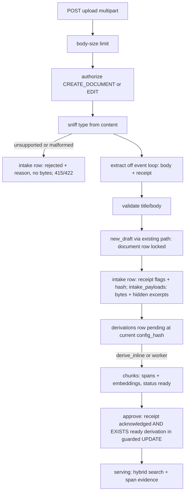
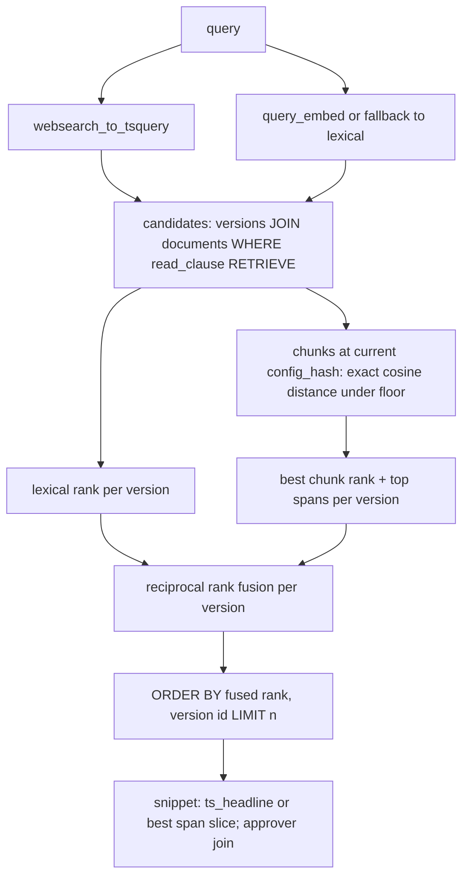

# Document Ingestion, Governed RAG and Graph - Plan

## Goal Capsule

- **Objective:** People in a Lattice workspace can turn the files they already have (Markdown, text, HTML, PDF, Word) into approved knowledge. Their agents can then find it by meaning as well as by keyword and cite the exact approved passage. A file never carries hidden or unreviewed content to an agent, and withdrawing a document removes everything derived from it.
- **Means:** Uploads enter the existing draft → approve path through per-type adapters. Every derived artifact (chunk, vector, graph mention) is keyed to an immutable version and read only through the existing `read_clause` (KTD3, KTD5, KTD14).
- **Product authority:** This plan's Key Decisions, `PRODUCT.md` positioning (one policy in two forms, approved-only retrieval, version-exact approval, denials look like missing, fail-closed audit), and the ideation survivors I1–I7 in `docs/ideation/2026-10-15-document-ingestion-rag-ideation.html`.
- **Open blockers:** None.
- **Stop conditions:** Stop and report if the fastembed 0.9.0 offline smoke test fails on the Python 3.13 image (KTD1), if vector or hybrid search cannot be made to agree with the reference model (R15), or if the purge cannot be made to run in the lifecycle transaction (R12).
- **Execution profile:** Brownfield extension of a well-tested FastAPI + Postgres app. Policy, audit and the property test are the safety net. Infra and schema land first, then extraction, the derivation core, retrieval, graph, UI, benchmark and docs.
- **Finishing:** Implemented, reviewed and shipped as one pull request by the `lfg` pipeline; merging stays with the repository owner.

---

## Product Contract

### Summary

Members upload files that become ordinary drafts, each with an extraction receipt the approver must acknowledge when it raises flags. Every pending and serving version is chunked into spans of its immutable body and embedded locally. Search becomes hybrid (keyword plus meaning) under the same read policy and returns checkable passage citations. A deterministic, query-time entity graph shows which readable documents mention which services. A benchmark proves extraction fidelity and zero permission leakage.

### Problem Frame

Lattice's governance is only useful if the knowledge people need is inside it. Today content enters only as text typed into a form (`backend/app/routers/documents.py` `DocumentBody`), so runbooks, architecture notes and incident reports that live as PDFs and Word files stay outside, and agents retrieve by keyword only. `PRODUCT.md` lists vector retrieval, file ingestion and citations as not built.

Adding them naively would break the promises Lattice sells. A parser between the file and the body would let approvers sign text they never saw. Hidden comments, tracked changes and white text would reach agents labelled "approved". Approximate vector search filters after ranking, which drops readable results and hints at hidden ones (`README.md` "Search cannot fetch the ten best matches and then drop the ones you may not read"). A GraphRAG summary merges facts across audiences. Withdrawal would leave embeddings behind. This plan adds ingestion and semantic retrieval so that each of those promises still holds and is tested.

### Requirements

**Upload and intake**

- R1. A member can upload a `.md`, `.txt`, `.html`, `.pdf` (text layer) or `.docx` file from the web UI. It becomes an unshared draft through the existing draft path and is reviewed, approved, shared and withdrawn exactly like a typed document.
- R2. The file type is detected from content, never from the filename or Content-Type. An unsupported, malformed, encrypted or over-limit file is rejected with a reason the uploader sees. An attempt rejected after authorization is recorded on an intake record with no file bytes kept; a request refused before authorization (R3, R6) records nothing.
- R3. Authorization happens before any parsing, and uploading is available only to signed-in people in the UI, never to agent tokens.
- R4. The original bytes of an accepted upload are kept while its version is pending or serving, identified by SHA-256, alongside a permanent intake record of the detected type, parser name and version, and outcome. No agent-facing path ever returns them.
- R5. Re-uploading a file identical to a live document the uploader authored creates nothing and points to that document. An upload whose title matches such a document is offered as a new version of it unless the uploader asks for a separate document. Uploading onto an existing document adds a pending version under the existing edit rules.
- R6. Document bodies may be up to 1,000,000 characters for typed and uploaded content alike, and upload requests above the configured byte limit are refused before the file is parsed.

**Extraction review**

- R7. Every accepted upload produces an extraction receipt. It records the parser and its version and per-page or per-section character counts, and flags empty or no-text pages, dropped tables, hidden-layer content (comments, tracked changes, hidden runs, HTML comments, hidden elements, scripts and styles), invisible characters (format characters, bidirectional controls and the Unicode tag block), content the parser could not account for, and HTML whose visibility cannot be determined.
- R8. Hidden-layer content and invisible characters are excluded from the body and shown, as escaped text, in a labelled section of the approval review.
- R9. Approving a version whose receipt has any flag is refused unless the approve request acknowledges that exact receipt. The acknowledgement is stored with the approval decision.

**Derivation lifecycle**

- R10. Every pending or serving version is derived (chunked and embedded) under the current pipeline configuration. Approve is refused with a distinct message until that version's derivation at the current configuration is ready.
- R11. Derivation status (pending, ready, failed with error) is visible to the author and managers, and failed derivations are retried automatically.
- R12. When a version stops being pending or serving (rejected, discarded, replaced by a newer draft, superseded by a newer approval, or withdrawn), everything derived from it is deleted in the same transaction: chunks, embeddings, its original bytes and its hidden-content excerpts. The audit trail receives a purge receipt counting what was removed per derived table.
- R13. Every table derived from versions is registered with its purge rule, and adding one without registering it fails the test suite.
- R14. A pipeline configuration change (embedding model, chunker version) re-derives every pending and serving version, and vector search only ever compares vectors from the current configuration.

**Retrieval**

- R15. Search in the UI and through MCP `search_knowledge` is hybrid: a version matches by keyword or by meaning above a similarity floor, and the read policy is applied before ranking and the result limit, using exact vector distance.
- R16. Each search result carries evidence spans (`start`, `end`, `sha256`) into the approved body. A meaning-only match takes its snippet from its best span.
- R17. MCP `get_evidence` accepts an optional span and returns exactly that slice of the approved body. A bad, out-of-range, foreign or unreadable span looks identical to "not found".
- R18. Audit rows for search and evidence record the returned spans as well as the returned versions.
- R19. When the embedder is unavailable, search still answers from keywords and reports that it did.
- R20. MCP still offers exactly two tools, and the declared argument list for each always matches its schema.

**Graph**

- R21. Managers maintain a per-workspace entity registry: a name plus aliases, for example `payments-gateway`.
- R22. For an entity, a person sees the approved versions they may read that mention it, with mention spans, and the entities co-mentioned in those versions. An entity or co-mention with no readable evidence is invisible to them, and no merged description is ever stored.
- R23. The graph is available in the web UI only.

**Proof and documentation**

- R24. A benchmark over the Acme seed plus hostile files reports extraction completeness, allowed-only Recall@k, denied-retrieval rate, citation resolution, deletion propagation and edge precision. Denied rate 0, citation resolution 100% and deletion propagation 100% are hard gates. With the real model, hybrid allowed-only Recall@5 on paraphrase questions that share no keywords with their target passages must beat keyword-only search, and off-topic queries must return nothing.
- R25. `PRODUCT.md`, `README.md` and `docs/mcp-client.md` describe exactly what ships; nothing unbuilt is implied.

### Key Decisions

- **Derive the draft locally; Approve waits for readiness.** (session-settled: user-approved — chosen over approving first with a visible lexical-only lag, and over deriving only after approval: approve then means fully searchable in one commit, and no draft text leaves the machine.) Governs R10.
- **v1 file types are Markdown, text, HTML, text-layer PDF and Word, with no OCR.** (session-settled: user-approved — chosen over Docling or OCR toolchains: far lighter, and a page with no text layer becomes a blocking receipt flag instead of silently blank text.) Governs R1, R7.
- **Body cap is 1,000,000 characters.** (session-settled: user-approved — chosen over keeping 200,000: the old cap rejects PDFs over about 60 pages.) Governs R6.
  - **Conflict call-out:** Postgres caps a `tsvector` at about 1 MB. A body with very high word diversity can exceed it below 1,000,000 characters. Such a body is refused with 422 `body_too_diverse` instead of failing; ordinary prose of that length fits.
- **A graph connection is visible if any of its supporting evidence is readable, and descriptions are never stored.** (session-settled: user-approved — chosen over requiring all evidence to be readable: that over-hides co-mentions, and not storing merged prose removes the leak.) Governs R22.
- **Uploading, receipt acknowledgement and the graph stay off MCP in this plan.** An agent acting as its user could otherwise plant drafts in the review queue, and graph traversal needs its own oracle before agents get it. Governs R3, R23.

### Scope Boundaries

Considered and not built:

- An HNSW or other approximate vector index. Exact distance over the permitted set keeps recall perfect and the policy oracle simple. Revisit when the latency report (U10) shows search p95 above 300 ms on a readable set above about 100,000 chunks (KTD6).
- A stored mentions table for the graph. Revisit when graph p95 exceeds 1 s or the readable corpus exceeds about 20 MB; the bill of derivatives (KTD9) makes adding it safe.
- Sharing one stored copy of identical bytes across documents. Per-intake copies cost some storage and remove a reference-counting race with withdrawal.
- Per-user upload rate limits and a derivation queue-depth display. The global extraction concurrency cap bounds the server; revisit if abuse or backlog is observed.
- OCR for scanned pages. They surface as blocking receipt flags instead (Key Decision on v1 file types).
- LLM entity extraction, relation typing and GraphRAG community reports. The deterministic registry is the baseline any of them must beat on the benchmark.
- Detecting invisible text inside PDFs. The receipt states that this check is not performed; it is not a blocking flag.
- Extracting DOCX tables into the body. They are flagged as dropped instead.
- A download endpoint for original bytes, zip or folder uploads, a manual "retry derivation" button, blue/green index generations, and content-hash embedding reuse. None was requested, and nothing here makes them harder later.

#### Deferred to Follow-Up Work

- Graph lookup and a "mentioned in" field over MCP, once a `visible_edges` oracle has run in the property test for a release.
- An `extraction_caveats` field on MCP evidence results.

### Sources

- Ideation: `docs/ideation/2026-10-15-document-ingestion-rag-ideation.html` (I1–I7 and the rejection table).
- Proposal: `governed-knowledge-store-thoughts.md` (graph section, "Apply permissions to supporting passages, graph relationships and any derived summaries").
- External: pgvector README (exact search by default; HNSW filters after the approximate scan), pgvector-python (SQLAlchemy `VECTOR`, async psycopg registration), FastEmbed `TextEmbedding` (`passage_embed`/`query_embed`, `cache_dir`, `local_files_only`, `FASTEMBED_CACHE_PATH`), pypdf security docs, python-docx issue #340 (tracked changes not exposed), FastAPI request-files docs (`UploadFile` spooling), Python 3.13 `zipfile` and `html.parser` docs, OWASP RAG and File Upload cheat sheets.

---

## Planning Contract

### Key Technical Decisions

- KTD1. **Embeddings come from fastembed 0.9.0 with `BAAI/bge-small-en-v1.5` (384 dimensions) behind an `Embedder` seam on `Settings`.** Passages use `passage_embed` and queries use `query_embed`. The model is downloaded into a fixed cache directory at image build, then loaded with `local_files_only`, so runtime never reaches the network. Tests inject a deterministic fake embedder. PyPI confirms 0.9.0 is not yanked and onnxruntime 1.31.0 ships cp313 manylinux wheels, but an offline smoke test on the built image is a release gate.
  - The build verifies the downloaded model file against a pinned SHA-256.
  - Startup asserts the embedder dimension is 384.
  - The embedder lock is held per batch (`embed_batch_size`, default 32), never per document, so a query embedding waits at most one batch.
  - `embedder_threads` bounds ONNX CPU use. (session-settled: user-approved — chosen over hosted embedding APIs: no API key, no PyTorch, nothing leaves the machine.)
- KTD2. **Postgres runs from `pgvector/pgvector:pg18` (extension 0.8.7) in `compose.yaml` and the test container.** `CREATE EXTENSION vector` goes in `db/init/01-roles.sql` as superuser, because the extension is not marked trusted and migrations run as `lattice_owner`. Migration `0002` only checks that the extension exists and fails with a clear message otherwise. (session-settled: user-approved — chosen over stock `postgres:18`.)
- KTD3. **Derivation has one core, `derive(version_id)`, run in three steps.**
  1. Read the body in a short transaction.
  2. Chunk and embed with no database locks held.
  3. In a second transaction, lock the document row `FOR SHARE`, re-check that the document is not withdrawn, the version is still its current pending or serving version, the config hash is current, and the ledger row still exists. Then insert chunks and mark ready. Otherwise discard the result and delete the ledger row if it remains.
  - **Worker:** an in-process loop in the app lifespan claims a due row with `FOR UPDATE SKIP LOCKED`, sets a lease (`next_attempt_at = now() + lease`), and commits before deriving. A crashed claim is retried when its lease expires.
  - **Ordering:** each tick enqueues current pending or serving versions of non-withdrawn documents that lack a row at the current hash, taking each document row `FOR SHARE` so the insert serializes with lifecycle purges. Drafts go before backfill.
  - **Inline mode:** `derive_inline` runs the same core inside create, edit and upload requests. Only tests and the seed turn it on, because `httpx.ASGITransport` never runs the lifespan.
  - **Lock order everywhere:** `documents` → `derivations` → `chunks` → `intake_payloads`.
  - Rejected: a separate worker service or external queue (more infrastructure, no gain at this size), and holding the document lock while embedding (blocks withdraw for seconds).
- KTD4. **The readiness check is an `EXISTS` inside the guarded `UPDATE documents` in `decide_draft`.** It looks for a ready derivation for that version at the current config hash. A refusal is a new 409 (`DERIVATIONS_NOT_READY`), distinct from `STALE_DRAFT` and raised after authorization. Rejected: SELECT-then-UPDATE, which races a config change or purge. Implements the Key Decision governing R10.
- KTD5. **Chunks are spans, not copies.** A chunk row holds the version, config hash, ordinal, `start`, `end`, `sha256` and the embedding, with no text column. Chunks are paragraph-aligned and capped at about 1,200 characters so the embedded input (title prefix plus chunk) stays under the model's 512-token limit. `derive` asserts each span's hash against `body[start:end]` and that the spans cover the body. The contextual prefix is the document title, recomputed at embed time and never stored or returned.
- KTD6. **Vector ranking uses exact cosine distance over chunks of versions passing `read_clause(RETRIEVE)`, in the same SQL statement, before `LIMIT`.** The vector candidate subquery keeps its nearest `vector_candidates` (default 50) before fusion, and a plain index on `chunks(version_id, config_hash)` supports the join. No vector index. Rejected for now: HNSW with iterative scans, which is still approximate and would need its own recall oracle. The revisit trigger is under Scope Boundaries.
- KTD7. **Hybrid fusion is reciprocal-rank fusion per version.** It merges the lexical rank (`ts_rank`) and the best-chunk vector rank, keeping vector candidates under a configurable cosine-distance floor. Results are aggregated per version before `LIMIT`, and each result carries its best spans (up to 3).
- KTD8. **The purge runs inside the lifecycle transaction, by exclusion.** After each guarded lifecycle `UPDATE`, delete every derived row of that document whose version is no longer its current pending or serving version (all of them on withdraw). The counts come from those deletes. A new `audit.record_system(db, workspace_id, action, detail)` writes the `channel='system'` purge receipt in the same transaction, failing closed. Bodies stay, because `document_versions` is immutable, and the receipt says so. Rejected: purging version ids read before the update (a concurrent edit can make them stale), and a queued purge (it can write a receipt before the rows are gone).
- KTD9. **One `DERIVED_TABLES` registry maps each derived table to its purge rule.** It lists `derivations` (chunks cascade from it) and `intake_payloads`. The purge iterates it. A schema test lists every table with a foreign key to `document_versions`, outside the core lifecycle tables and the permanent `intakes` record, and fails when one is missing from the registry.
- KTD10. **`config_hash` is the SHA-256 of the model name, fastembed version, dimension and chunker version.** The worker derives any pending or serving version with no ready row at the current hash, then deletes that version's rows at older hashes. Approve and vector search read only the current hash. A config change deploys as a single-process stop and start, so two hashes never compete.
- KTD11. **Upload is `POST /api/workspaces/{workspace_id}/documents/upload` (multipart: `file`, optional `title`, optional `document_id`, optional `new_document`).**
  - **Title:** the `title` field when given. Otherwise a new document takes the filename without its extension, and a new version takes its document's current title. The result has invisible characters stripped and is truncated to the title limit. Title matching (R5) compares this resolved title with the uploader's live document titles, case-insensitively after trimming.
  1. A path-scoped ASGI wrapper runs before multipart parsing and before any database work.
     - It refuses requests without a valid session cookie.
     - It answers 429 when `upload_max_inflight` uploads (default 4, below the database pool size) are already in progress.
     - It counts bytes as they stream, aborting with 413 past `upload_max_bytes` (default 20 MB) whether or not `Content-Length` is present.
  2. Authorization comes next: `CREATE_DOCUMENT`, or `EDIT` when a `document_id` is given.
  3. Content sniffing: `%PDF-` means PDF. A zip containing `word/document.xml` means DOCX. Anything else must be strict UTF-8, and the extension then chooses md, txt or html.
  4. Extraction runs in a child process killed at `extract_timeout_seconds`. An address-space limit is applied where the platform supports it (the Linux image and CI); on macOS development machines it is skipped with a logged warning, and the timeout, page cap and zip bounds still apply. A global semaphore (`extract_concurrency`) bounds in-flight extractions.
  5. The write order is document and draft (`new_draft`), then the intake and its payload. A transaction-scoped advisory lock on (workspace, author, sha256) serializes the dedupe check.
  6. Rejections after authorization (unsupported type, malformed or encrypted file, zip, page or decompressed-size limits, timeout) are persisted as intakes with a reason and no receipt or payload, through `CommitThenRaise`, and answered 415 or 422. Filename and reason are truncated to 256 characters. The pre-authorization 401, 413 and 429 responses write nothing.
- KTD12. **Extractors are stdlib plus pypdf 6.20.1 and python-docx 1.2.0.**
  - **PDF:** `PdfReader(strict=True)` with a declared-stream cap and a page cap. Encrypted files are rejected, and a page whose `extract_text()` is empty is flagged.
  - **DOCX:** the body comes from top-level paragraphs via python-docx. A namespace-aware, entity-free scan of the raw OOXML parts flags comments, `w:ins`/`w:del`/`w:moveFrom`/`w:moveTo`, `w:vanish` and white text. A character-accounting check (all `w:t` text vs. extracted plus flagged) flags anything unaccounted for, such as text boxes, footnotes and headers.
  - **Zip:** member count, per-member size, total size and compression ratio are bounded, with no extraction to disk.
  - **HTML:** a `html.parser` stack extractor drops comments, `script`, `style`, `template`, `noscript`, `[hidden]`, `aria-hidden="true"` and inline `display:none`/`visibility:hidden` subtrees. `visibility_ambiguous` is raised only for an external stylesheet link, or a `<style>` block or `style` attribute containing a hiding declaration (`display:none`, `visibility:hidden`, `opacity:0`, `font-size:0`, or off-screen positioning). Class attributes alone do not raise it, so routine wiki and CMS exports carry no flag.
  - **Markdown:** HTML comments are removed and flagged.
  - **All types:** format characters (Unicode category Cf), bidirectional controls and the tag block U+E0000–E007F are stripped from the body and flagged `invisible_chars`. Text decodes as `utf-8-sig`, so a leading byte-order mark is dropped silently, and soft hyphens (U+00AD) are stripped without a flag.
  - **Notes:** the receipt also carries non-blocking `notes`, included in its hash but never counted as flags. Every PDF receipt carries `pdf_invisible_text_not_checked`.
  - **Size:** a body whose `tsvector` would exceed the Postgres limit is refused with 422 `body_too_diverse`.
- KTD13. **The receipt is split into a permanent part and a purgeable part.**
  - The permanent intake row holds the receipt flags, the section counts and a SHA-256 over them plus the digest of each hidden excerpt.
  - The hidden excerpt text and the original bytes live in a purgeable `intake_payloads` row, so the acknowledgement hash still verifies after a purge.
  - The approve body gains an optional `acknowledged_receipt`, and `version_decisions` gains a nullable `acknowledged_receipt_sha256`.
  - Rejected: keeping excerpts on the immutable intake row (hidden content would outlive withdrawal), and a separate acknowledgement table (heavier for no benefit given `g_decision`'s exact-table assertion).
- KTD14. **The graph is computed at query time in SQL, and only the registry is stored.**
  - Aliases are matched as escaped literals, case-insensitively on word boundaries, against bodies of versions passing `read_clause(RETRIEVE)`, inside the same statement.
  - Mention spans are the match positions. Co-mentions are the other registry entities found in those same versions.
  - Members see an entity only when it has a readable mention, and see only the aliases that have one. Managers see the whole registry.
  - Entities per workspace (default 200), aliases per entity (default 20) and alias length (default 100) are capped on write.
  - Shortcut: each graph query scans the readable corpus. The revisit trigger is under Scope Boundaries.
- KTD15. **The MCP surface stays two tools.** `search_knowledge` results gain `spans` and `retrieval` (`hybrid` or `lexical`), and `get_evidence` gains optional `start` and `end`. A test asserts that `DECLARED` equals each tool's schema properties. New actions (upload, entity management, graph read) are denied on the MCP channel by the existing allowlist, with guard tests.
- KTD16. **Audit `detail` for search and evidence gains `returned_spans` as `[version_id, start, end]` triples.** `returned_version_ids` keeps listing distinct versions in result order, so existing audit grounds still hold.
- KTD17. **The benchmark lives in `backend/tests/benchmark/` behind the `benchmark` marker.** It uses deterministic hostile-file builders shared with the extractor tests. The permission, citation and deletion gates run in CI with the fake embedder. Real-model recall runs behind a separate `benchmark_model` marker that needs the cached model.

### High-Level Technical Design

Upload to serving, one transaction per arrow group:

Version × derivation lifecycle (the worker claim guard and the property machine both follow this):

```mermaid
stateDiagram-v2
  [*] --> PendingDerivation: draft created (typed, edited or uploaded)
  PendingDerivation --> Ready: derive succeeds at current config_hash
  PendingDerivation --> Failed: derive raises
  Failed --> PendingDerivation: retry after backoff
  Ready --> PendingDerivation: config_hash changes
  Ready --> Serving: approve (receipt acknowledged, EXISTS ready)
  PendingDerivation --> Purged: rejected / discarded / replaced / withdrawn
  Ready --> Purged: rejected / discarded / replaced / withdrawn
  Serving --> Purged: superseded by newer approval or withdrawn
  Purged --> [*]: derived rows deleted in same transaction; system purge receipt
```

Retrieval composition (one statement per search):

### Assumptions

- Failed derivations are retried with exponential backoff and no attempt cap, and the last error stays visible. There is no manual retry button.
- Upload limits default to 20 MB per request, 500 PDF pages, 1,000 zip members, 50 MB total uncompressed and a 100:1 compression ratio. All are settings.
- The cosine-distance floor default is chosen from the real-model benchmark run (R24), not fixed in advance.
- Whoever approves acknowledges the receipt. Existing self-approval rules and audit detail are unchanged.
- The seed derives with the real embedder inside the container image. Every test uses the fake embedder except the `benchmark_model` marker.
- Purge receipts appear on the existing audit page for managers, and the page tolerates a null actor and the `system` channel.
- Rejected intakes keep no bytes; the reason and detected type are enough to audit them.
- Versions that exist before this change are derived by the worker's per-tick sweep, and keyword search covers them until then.
- `derive_inline` stays off in production. A very large body derived inline holds its request for the full embedding time, which is acceptable only in tests and the seed.
- Embedding throughput is roughly 30–70 chunks per second on one CPU worker. A full re-derivation after a config change takes tens of minutes for about 10,000 documents. During that time approve waits on new drafts and older versions answer from keywords only.
- The request transaction stays open during extraction, up to `extract_timeout_seconds`. That is accepted at this scale.

### System-Wide Impact

- **Lifecycle and audit:**
  - Every lifecycle transition gains a purge step and a system audit row, in the same transaction, after the guarded update (KTD8).
  - Approve gains two refusals (KTD4, KTD13).
  - The existing endpoint grounds that assert exact changed tables (`g_create_document`, `g_edit`, `g_decision`, withdraw) must be updated for the new tables.
- **Agent surface:** MCP keeps two tools, gains span arguments and fields, and is guarded by the `DECLARED` equality test (KTD15). Upload, receipt acknowledgement and the graph stay human-only.
- **Policy:** No read rule changes. Every new read (chunks, graph) composes `read_clause`, so the property test covers it. New actions are denied on the MCP channel by the existing allowlist.
- **Infrastructure:**
  - The database image, the init script and the app image change.
  - Existing `pgdata` volumes need the extension created once.
  - The app now runs a background loop, and its CPU use is bounded by `embedder_threads` and `extract_concurrency`.
- **Tests:** Test helpers, the endpoint world and the property machine run with `derive_inline` and the fake embedder. A conftest guard fails any property run that is not using the fake embedder.

### Risks & Dependencies

| Risk | Decision |
|---|---|
| Malicious files exhaust CPU or memory | Killable child process, memory limit, timeout and concurrency cap (KTD11). Parser library CVEs are watched through pinned versions. |
| Hidden instructions reach agents through approved text | Hidden layers and invisible characters are excluded and flagged (KTD12), and approval of flagged versions requires acknowledgement (KTD13). Visible text is the approver's responsibility, and MCP labels evidence as data, not instructions. |
| Lock contention or deadlock between the worker and lifecycle actions | Embedding runs with no locks held, under one global lock order (KTD3). |
| Purge receipt claims rows that remain | Purge by exclusion in the lifecycle transaction, plus a registry guard and a canary test (KTD8, KTD9). |
| A chunk ledger marked ready with no chunks | Chunks have a cascading foreign key to their derivation row, and a body always yields at least one chunk (U2, U5). |
| A swapped or tampered embedding model | The model file hash is pinned and checked at build (KTD1). |
| Exact vector scan or graph scan becomes slow | Bounded candidate set and index (KTD6). Measured by the U10 latency report, with revisit triggers under Scope Boundaries. |
| fastembed or onnxruntime breaks on the production image | Offline smoke test as a release gate (KTD1). |

### Sequencing

U1 and U2 come first, in that order, because the `alembic check` test requires models and migration to match. U3 is independent of the database, so it can be built alongside U2. U4 needs U2 and U3. U5 needs U2 and the embedder seam from U1. U6 depends on U5. U7 depends on U5. U8 needs only U2. U9 consumes the APIs from U4 through U8. U10 needs everything else, and U11 lands last.

---

## Implementation Units

| U-ID | Title | Key files | Depends on |
|---|---|---|---|
| U1 | Infrastructure, dependencies and embedder seam | `compose.yaml`, `db/init/01-roles.sql`, `Dockerfile`, `backend/pyproject.toml`, `backend/app/embedding.py` | none |
| U2 | Schema: intakes, payloads, derivations, chunks, entities, acknowledgement | `backend/app/models.py`, `backend/app/migrations/versions/0002_ingestion.py` | U1 |
| U3 | Content sniffing, extractors and receipts | `backend/app/ingest/` | U1 |
| U4 | Upload API, dedupe and receipt acknowledgement | `backend/app/routers/documents.py`, `backend/app/services/intake.py` | U2, U3 |
| U5 | Derivation core, ledger worker and approve readiness | `backend/app/services/derive.py`, `backend/app/services/documents.py`, `backend/app/main.py` | U1, U2 |
| U6 | Lifecycle purge, purge receipts and bill of derivatives | `backend/app/derived.py`, `backend/app/audit.py`, `backend/app/services/documents.py` | U5 |
| U7 | Hybrid policy-first retrieval and span evidence | `backend/app/services/search.py`, `backend/app/mcp_server.py` | U5 |
| U8 | Entity registry and query-time graph | `backend/app/services/graph.py`, `backend/app/routers/entities.py`, `backend/app/policy.py` | U2 |
| U9 | Web UI: upload, receipt review, status, spans, entities | `frontend/src/api.ts`, `frontend/src/components/ReviewCard.vue`, `frontend/src/pages/` | U4–U8 |
| U10 | Benchmark and seed alignment | `backend/tests/benchmark/`, `backend/app/seed.py` | U3–U8 |
| U11 | Product and client documentation | `PRODUCT.md`, `README.md`, `docs/mcp-client.md` | U1–U10 |

### U1. Infrastructure, dependencies and embedder seam

- **Goal:** The app and tests run on Postgres with pgvector, the new libraries are declared and locked, the image carries an offline embedding model, and code obtains embeddings through one seam.
- **Requirements:** R6, R14, R19; KTD1, KTD2.
- **Dependencies:** none.
- **Files:** `compose.yaml`, `db/init/01-roles.sql`, `backend/tests/conftest.py`, `Dockerfile`, `backend/pyproject.toml`, `backend/uv.lock`, `backend/app/config.py`, `backend/app/embedding.py`, `backend/app/services/documents.py` (`MAX_BODY`), `.github/workflows/ci.yml`, `backend/tests/test_embedding.py`, `backend/tests/test_documents.py`.
- **Approach:**
  1. Swap the image string in `compose.yaml` and `backend/tests/conftest.py` to `pgvector/pgvector:pg18`.
  2. Add `CREATE EXTENSION IF NOT EXISTS vector;` after `\connect lattice` in `db/init/01-roles.sql`.
  3. Declare `pgvector`, `fastembed==0.9.0`, `pypdf`, `python-docx` and `python-multipart` explicitly, then regenerate `uv.lock`.
  4. In the Dockerfile, set `FASTEMBED_CACHE_PATH` to a directory owned by the runtime user. Warm the model there in a build step before `USER`, check the model file against a pinned SHA-256, and set `HF_HUB_OFFLINE=1` at runtime.
  5. Add settings: `embedder` (`fastembed` | `fake`), `embedding_cache_path`, `embed_batch_size`, `embedder_threads`, `derive_inline`, `derive_poll_seconds`, `derive_lease_seconds`, `upload_max_bytes`, `upload_max_inflight`, `extract_timeout_seconds`, `extract_memory_bytes`, `extract_concurrency`, the extraction limits, `vector_distance_floor`, `vector_candidates`, `chunk_max_chars`, and the graph caps.
  6. Write `embedding.py` with an `Embedder` protocol (`embed_passages`, `embed_query`, `dimension`, `config_identity`) and two implementations:
     - `FastEmbedder` constructs lazily once and runs blocking work through `asyncio.to_thread`, under a lock held per batch.
     - `FakeEmbedder` is deterministic: it hashes lowercased terms into 384 buckets and normalizes, so shared words give high similarity.
     - Startup asserts the dimension is 384.
  7. Add a conftest guard that fails the property suite unless the fake embedder is configured.
  8. Raise `MAX_BODY` to 1,000,000 (Key Decision on the body cap). Map the Postgres tsvector size error on insert to 422 `body_too_diverse`.
- **Execution note:** Run the worst-case body tests before anything else depends on the new cap.
- **Patterns to follow:** `backend/app/config.py` `LATTICE_*` settings; `conftest.py` image-and-replay pattern.
- **Test scenarios:**
  - The test database reports the `vector` extension installed after `01-roles.sql` replays.
  - `FakeEmbedder` returns 384-length unit vectors, is deterministic across calls, and gives two texts sharing a rare word a higher similarity than unrelated texts.
  - A 1,000,000-character body of ordinary prose is accepted, and 1,000,001 characters is refused by `validate`.
  - A body of random distinct tokens large enough to exceed the tsvector limit returns 422 `body_too_diverse`, not 500, and stores nothing.
  - A query embedding completes while a long passage batch sequence is in flight (the lock is per batch).
  - Under the `benchmark_model` marker, `FastEmbedder` with `local_files_only` embeds one passage and one query offline. A missing cache raises a clear error instead of downloading.
- **Verification:** The full existing suite passes on the pgvector image, and `docker compose build` produces an image whose offline smoke command embeds text.

### U2. Schema: intakes, payloads, derivations, chunks, entities, acknowledgement

- **Goal:** Migration `0002` and matching models add every table this feature stores, with workspace-scoped composite foreign keys and explicit grants.
- **Requirements:** R4, R7, R9, R10, R11, R13, R21; KTD2, KTD5, KTD9, KTD10, KTD13.
- **Dependencies:** U1.
- **Files:** `backend/app/models.py`, `backend/app/migrations/versions/0002_ingestion.py`, `backend/app/migrations/env.py` (only if `alembic check` needs the vector type registered), `backend/tests/test_schema.py`, `backend/tests/endpoint_world.py` (`TENANT_TABLES`).
- **Approach:**
  1. Add the tables, each carrying `workspace_id`:
     - `intakes` (permanent): workspace, actor, filename and reason (each at most 256 characters, by check), detected type, parser, parser version, outcome `accepted|rejected`, receipt JSON (flags and counts only), receipt sha256, source sha256, `document_id`, `version_id` (both null on rejects), created_at.
     - `intake_payloads` (purgeable): intake id (primary key), workspace, document, version, original bytes, hidden excerpts JSON.
     - `derivations`: workspace, document, version, config hash, status `pending|ready|failed`, attempts, error, `next_attempt_at`, updated_at. Unique `(version_id, config_hash)`.
     - `chunks`: workspace, document, version, config hash, ordinal, start, end, sha256, `embedding vector(384)`. Composite foreign key `(version_id, config_hash)` to `derivations` with `ON DELETE CASCADE`, and an index on `(version_id, config_hash)`.
     - `entities`: workspace, name, unique per workspace.
     - `entity_aliases`: workspace, entity, alias, unique per workspace.
  2. Add a nullable `acknowledged_receipt_sha256` column to `version_decisions`.
  3. Composite foreign keys follow the `version_decisions` pattern `(workspace_id, document_id)` and `(document_id, version_id)`.
  4. Grants: `intakes` is SELECT/INSERT only. `intake_payloads`, `derivations`, `chunks`, `entities` and `entity_aliases` get SELECT/INSERT/UPDATE/DELETE for `lattice_app`.
  5. The migration first asserts that the `vector` extension exists (KTD2).
  6. Register every new tenant table in `TENANT_TABLES`.
- **Patterns to follow:** `backend/app/migrations/versions/0001_initial_schema.py` (explicit constraint names, `*_check` constraints, per-tier grants, forward-only `downgrade`); `models.py` `_id()` / `_created()` helpers.
- **Test scenarios:**
  - `alembic check` reports no drift with the vector column present.
  - A chunk referencing a version from another workspace is rejected by the composite foreign key.
  - `lattice_app` cannot UPDATE or DELETE `intakes` rows (`InsufficientPrivilege`).
  - A second `derivations` row for the same version and config hash violates the unique constraint.
  - Deleting a `derivations` row deletes its chunks.
  - An intake filename longer than 256 characters violates its check.
  - `lattice_app` still owns no objects.
- **Verification:** The schema tests pass, and the endpoint matrix sees the new tables in its snapshots.

### U3. Content sniffing, extractors and receipts

- **Goal:** Pure, database-free functions turn bytes plus a filename into a detected type, a body and a receipt, or a typed rejection, within resource limits.
- **Requirements:** R2, R7, R8; KTD11, KTD12, Key Decision on v1 file types.
- **Dependencies:** U1.
- **Files:** `backend/app/ingest/__init__.py`, `backend/app/ingest/sniff.py`, `backend/app/ingest/pdf.py`, `backend/app/ingest/docx.py`, `backend/app/ingest/html.py`, `backend/app/ingest/text.py`, `backend/app/ingest/receipt.py`, `backend/tests/hostile_files.py`, `backend/tests/test_ingest.py`.
- **Approach:**
  1. `extract(data, filename, limits)` returns `Extraction(detected_type, parser, parser_version, body, receipt)` or raises `Rejected(reason, status)`.
  2. The receipt is a dataclass with `sections` (index, chars, flags), `flags` (kind, location, count), `notes` (non-blocking) and `hidden` (escaped excerpts), plus a canonical-JSON serializer with a sha256.
  3. Text types decode strict UTF-8 (`utf-8-sig`), strip NUL and lone surrogates (or reject), and normalize newlines.
  4. Every extractor passes its body through one invisible-character filter (KTD12).
  5. `hostile_files.py` builds fixtures in memory, deterministically:
     - a text file with zero-width spaces, a right-to-left override and tag-block characters;
     - a PDF with a text page and a no-text page, plus an encrypted PDF (both hand-built minimal PDFs);
     - a DOCX with a comment, `w:ins`, `w:del`, `w:vanish`, white text, a table and a text box (python-docx plus raw XML edits);
     - HTML with a hidden div, `<script>` and a comment;
     - Markdown with an HTML comment;
     - a zip bomb, a traversal-named member, and a disguised extension.
- **Execution note:** Implement test-first against the hostile fixtures; they double as benchmark ground truth (U10).
- **Patterns to follow:** None in-repo for parsing. Keep modules small and side-effect-free like `backend/app/security.py`.
- **Test scenarios:**
  - A `.pdf` filename on a DOCX zip is detected as DOCX, and a `.docx` filename on plain text is rejected as unsupported.
  - A PDF with one text page and one image-only page yields the text body, section char counts `[n, 0]`, and an `empty_page` flag on page 2.
  - An encrypted PDF is rejected with reason `encrypted`.
  - A DOCX with a comment, tracked insertion, tracked deletion, `w:vanish` run and white text: none of those strings appear in the body; each produces its flag; the hidden excerpts contain them.
  - A DOCX with a table flags `dropped_table` with count 1, and a text box raises `unaccounted_content`.
  - HTML with `
secret
`, `<script>`, a comment and `display:none` keeps only visible text, and a page with a `class` attribute raises `visibility_ambiguous`.
  - Markdown with `<!-- note -->` excludes the comment and flags it.
  - A zip with 2,000 members, a 1000:1 ratio member, or `../evil` is rejected before any member is read beyond the limits.
  - Invalid UTF-8 in a `.txt` file is rejected with reason `encoding`.
  - A clean text-layer PDF yields the `pdf_invisible_text_not_checked` note and no flags.
  - A typical wiki HTML export with class attributes and a stylesheet `<style>` block without hiding declarations has no flags. Adding `.x{display:none}` to that block raises `visibility_ambiguous`.
  - A UTF-8 text file starting with a byte-order mark and containing soft hyphens has no flags and none of those characters in the body.
  - A text file with zero-width, bidirectional-override and tag-block characters yields a body without them and an `invisible_chars` flag. The excerpts show them escaped.
  - The receipt sha256 is stable for identical input and changes when any flag changes.
- **Verification:** Every hostile fixture produces the expected body, flags and rejections, and no excluded string appears in any body.

### U4. Upload API, dedupe and receipt acknowledgement

- **Goal:** People upload files from the UI into drafts or new versions, and approvers can approve flagged versions only by acknowledging the exact receipt.
- **Requirements:** R1–R9; KTD11, KTD13; Key Decision keeping upload off MCP.
- **Dependencies:** U2, U3.
- **Files:** `backend/app/routers/documents.py`, `backend/app/services/intake.py`, `backend/app/services/documents.py`, `backend/app/main.py` (path-scoped body limit), `backend/app/policy.py` (only if a distinct `Action` is needed for audit naming), `backend/tests/test_upload.py`, `backend/tests/helpers.py`, `backend/tests/test_endpoint_matrix.py` or `backend/tests/test_endpoint_global.py`, `backend/tests/endpoint_grounds.py`.
- **Approach:**
  1. Steps follow KTD11. With `document_id`, reuse the edit path (`authorize(EDIT)`, author-only) and `new_draft`. Otherwise, check dedupe and title match (KTD11 title rule and step 5), then create the document.
  2. A title match returns 409 with `{"suggest_document_id"}` unless `new_document=true`. A hash match among the uploader's own live documents returns 200 with the existing document id and `created: false`.
  3. Accepted uploads write, in the request transaction and in the KTD11 order, the draft, then the intake row (flags, receipt sha256, version id), then its `intake_payloads` row (bytes, hidden excerpts).
  4. Extend review (`GET …/review`) with `receipt`, `intake` and `derivation` (status and last error) keys, visible only where the pending version is visible today.
  5. Extend approve (`VersionRef`) with an optional `acknowledged_receipt`. When the pending version's intake receipt has flags and the acknowledgement does not equal its sha256, refuse with 409 `RECEIPT_NOT_ACKNOWLEDGED`. Store the acknowledged hash on the `VersionDecision` row.
  6. Versions with no intake (typed or JSON-edited) skip the receipt check.
  7. Bearer tokens are already refused on `/api`; add a guard test proving it for the upload route.
  8. Add multipart support to the endpoint matrix `Case` or a `@covers` test, and update `g_create_document`-style grounds for the new tables.
- **Patterns to follow:** `create_document` and `_decide_draft` in `backend/app/routers/documents.py`; `CommitThenRaise` in `backend/app/db.py` / `backend/app/audit.py`; `test_audit.py` fail-closed monkeypatch.
- **Test scenarios:**
  - A member uploads a clean `.md`: 201, an unshared draft whose body equals the extracted text, an accepted intake with its source sha256, a payload row, and an audit row with `channel='ui'`.
  - An outsider's upload returns the exact 404 body, no parser runs (assert via a patched extractor that raises), and nothing is stored.
  - A request with no session cookie is refused before its body is read.
  - An upload over `upload_max_bytes` returns 413, with and without `Content-Length` (chunked transfer).
  - With `upload_max_inflight` uploads in progress, one more upload returns 429 while an ordinary API call still succeeds.
  - With no `title` field, a file named `Runbook — failover​.md` becomes a draft titled `Runbook — failover`. A new version uploaded with `document_id` keeps the document's title.
  - An extraction that exceeds `extract_timeout_seconds` returns 422 and its child process is gone.
  - An unsupported type returns 415 and writes a rejected intake row with a reason and no payload.
  - Uploading the same bytes twice as the same author returns the first document with `created: false`. The same bytes uploaded by a different author create a new draft.
  - A title that matches the author's live document returns 409 with the suggestion, and `new_document=true` creates a separate document.
  - An upload with `document_id` by a non-author returns the edit-denial 404. By the author, it adds a pending version and the serving version keeps serving.
  - The review for a flagged upload includes the receipt flags and escaped hidden excerpts.
  - Approving a flagged version without acknowledgement returns 409 `RECEIPT_NOT_ACKNOWLEDGED`. With the wrong hash it returns 409. With the right hash it returns 200 and the hash is stored on the decision row.
  - A typed document approves with no acknowledgement field (unchanged behaviour).
  - When the audit insert is forced to fail during upload, no draft, intake or payload remains.
  - A personal access token POST to the upload route is refused.
- **Verification:** The route-coverage guard passes with the new route grounded for every actor, and all of the above pass.

### U5. Derivation core, ledger worker and approve readiness

- **Goal:** Every pending and serving version gets span chunks and embeddings at the current config. Approve waits for them atomically, and status is visible.
- **Requirements:** R10, R11, R14; KTD3, KTD4, KTD5, KTD10; Key Decision governing R10.
- **Dependencies:** U1, U2.
- **Files:** `backend/app/services/derive.py`, `backend/app/services/documents.py` (`new_draft`, `decide_draft`), `backend/app/routers/documents.py` (status in document detail), `backend/app/main.py` (lifespan worker), `backend/tests/test_derive.py`, `backend/tests/helpers.py`, `backend/tests/endpoint_world.py`, `backend/tests/endpoint_grounds.py`, `backend/tests/test_policy_properties.py`.
- **Approach:**
  1. `new_draft` inserts a pending `derivations` row at the current config hash and, when `derive_inline` is on, calls `derive` in the same transaction.
  2. `derive` follows the three steps of KTD3:
     - Chunk with paragraph-aligned spans up to `chunk_max_chars`, and assert hashes and coverage.
     - Embed the title prefix plus each chunk.
     - On commit, insert the chunks, mark the derivation ready, and delete that version's older-hash rows.
     - On failure, set failed status, the error, and backoff `next_attempt_at`.
  3. The worker loop runs a tick every `derive_poll_seconds`:
     - Sweep: enqueue current pending or serving versions of non-withdrawn documents lacking a row at the current hash.
     - Claim one due row (pending, or failed past backoff, or lease expired), drafts first, with `FOR UPDATE SKIP LOCKED` and a lease, then commit.
     - Derive the claimed version.
  4. `decide_draft` adds `EXISTS (ready derivation for version at current hash)` to its guarded `UPDATE`. When the row count is 0 and the pending pointer still matches, raise `DERIVATIONS_NOT_READY`.
  5. Document detail exposes derivation status to the author and managers only.
  6. Tests and the seed run with `derive_inline=True`. The property machine gets a rule that bumps the config hash, and asserts that approve is refused while derivation is pending.
- **Technical design:** Directional only. The guarded update reads as "set serving = pending where id matches and pending is this version and not withdrawn and exists(ready derivation for this version at hash H)". The 409 is distinguished from `STALE_DRAFT` by re-reading the pointer after a zero row count.
- **Patterns to follow:** `decide_draft` guarded update and `STALE_DRAFT`; `main.py` lifespan; `db.py` sessionmaker usage.
- **Test scenarios:**
  - Creating a typed document with `derive_inline` produces chunks whose spans tile the body without gaps, with matching sha256 values and a ready derivation.
  - With `derive_inline` off, approve returns 409 `DERIVATIONS_NOT_READY`. After one worker tick it succeeds.
  - Covers the Key Decision governing R10: a config-hash change between derive and approve makes approve refuse until re-derived.
  - A draft replaced while its embedding is in flight is not written: the step-3 re-check finds it no longer current.
  - A withdraw issued while a derivation is embedding completes without waiting for the embedding.
  - A pending draft with no ledger row (created before the upgrade) is derived on the next tick without a restart.
  - A claim whose worker died is retried after its lease expires.
  - A withdraw that commits between a derivation's read and its write leaves no ledger or chunk rows for the document.
  - A failed embedder marks the row failed with the error, and the next tick after the backoff retries it.
  - Two worker loops on the same ledger never derive the same version twice (SKIP LOCKED).
  - On worker start, serving versions with no current-hash rows are enqueued (backfill).
  - The property machine shows no read-path disagreement with the extra config-bump and pending-approve rules.
- **Verification:** The existing create-then-approve tests pass unchanged with `derive_inline`, and the new readiness tests pass.

### U6. Lifecycle purge, purge receipts and bill of derivatives

- **Goal:** Derivatives never outlive the version state that justified them, every removal is receipted in the audit trail, and no future derived table can skip this.
- **Requirements:** R12, R13; KTD8, KTD9.
- **Dependencies:** U5.
- **Files:** `backend/app/derived.py`, `backend/app/audit.py` (`record_system`), `backend/app/services/documents.py` (reject, discard, replace in `new_draft`, supersede in `decide_draft`, `withdraw`), `backend/tests/test_purge.py`, `backend/tests/test_schema.py`, `backend/tests/test_audit.py`, `backend/tests/endpoint_grounds.py`.
- **Approach:**
  1. `DERIVED_TABLES` maps `derivations` (chunks cascade) and `intake_payloads` to "delete by version".
  2. `purge_document(db, document_id, reason)` runs after each guarded lifecycle update. It deletes, through the registry, rows of that document whose version is not its current pending or serving version (all rows after withdraw). It then writes one `record_system` row with the per-table counts, the reason, and the note that version bodies are retained.
  3. Call it from every transition named in R12, in the same transaction.
  4. `record_system` writes `channel='system'` with a null actor and fails closed.
  5. A schema test reflects metadata for tables with a foreign key to `document_versions`, other than the core lifecycle tables, and asserts that each is in `DERIVED_TABLES`.
  6. A test-only canary creates, derives, approves and withdraws a document. It then asserts that zero rows reference it in every registered table and that search finds nothing.
- **Patterns to follow:** `audit.record` transaction and flush semantics; the route-coverage guard style in `test_endpoint_global.py`.
- **Test scenarios:**
  - Rejecting a derived draft deletes its chunks and derivation rows and writes a system purge receipt with counts.
  - Approving v2 deletes v1's chunks (superseded), and v2's remain.
  - An edit that replaces a pending draft purges the old draft's chunks.
  - Withdrawing deletes chunks, payloads and hidden excerpts for every version, and the receipt says bodies are retained.
  - Rejecting an upload deletes its original bytes and hidden excerpts, while its intake row with flags and receipt hash remains.
  - An edit racing a withdraw leaves no derived row for the document once both commit.
  - When the system audit insert is forced to fail during withdraw, the document is not withdrawn and the chunks remain (fail closed).
  - Adding a dummy model table with a foreign key to `document_versions` and no registry entry makes the bill-of-derivatives test fail. Verify by temporarily registering a table in the test's metadata copy.
  - Canary: after withdrawal, every registered table has zero rows for the document, and no hidden-excerpt text from it exists anywhere in the database.
- **Verification:** Every lifecycle exit is covered by a purge test, and the audit page lists system purge rows for managers.

### U7. Hybrid policy-first retrieval and span evidence

- **Goal:** UI search and MCP find approved knowledge by keyword or meaning under the unchanged read policy, and return checkable spans.
- **Requirements:** R15–R20; KTD6, KTD7, KTD15, KTD16.
- **Dependencies:** U5.
- **Files:** `backend/app/services/search.py`, `backend/app/routers/search.py`, `backend/app/mcp_server.py`, `backend/tests/reference_model.py`, `backend/tests/test_search.py`, `backend/tests/test_mcp.py`, `backend/tests/test_policy_properties.py`, `backend/tests/test_endpoint_global.py`, `backend/tests/endpoint_grounds.py`.
- **Approach:**
  1. `search()` embeds the query (fallback to lexical on embedder error, `retrieval="lexical"`).
  2. It builds one statement following the retrieval-composition diagram, reusing `read_clause(subject, Action.RETRIEVE, d, v)` exactly as today, with the vector candidates capped at `vector_candidates` (KTD6). Confirm with `EXPLAIN` that the workspace filter applies before the distance sort.
  3. Results gain `spans` (up to 3 best chunks: `start`, `end`, `sha256`) and `retrieval`. The snippet for a vector-only hit is the escaped best-span slice, truncated.
  4. MCP `get_evidence(version_id, start=None, end=None)` re-checks retrievability, validates `0 <= start < end <= len(body)` and returns `body[start:end]` with the span. Every failure raises the same `NOT_FOUND`.
  5. `DECLARED` is updated, and a test compares it to each tool's input schema.
  6. Audit detail gains `returned_spans`.
  7. In the reference model, `retrievable_versions` is unchanged. The property invariant also runs a vector-only query that the fake embedder maps to every body (the shared term) and asserts the result versions equal the model's, and that every returned span re-slices to its sha256.
  8. A mutation test patches the vector candidate subquery to drop `read_clause` and expects the property to fail.
- **Patterns to follow:** `services/search.py` inner `matches` subquery; AE10 in `tests/test_search.py`; `test_the_property_catches_a_broken_read_rule` in `test_policy_properties.py`; MCP refusal uniformity in `test_mcp.py`.
- **Test scenarios:**
  - A query sharing no keyword with a document but close in meaning (fake embedder bucket overlap) returns it with `retrieval="hybrid"` and a span snippet.
  - Covers AE10 for vectors: ten unreadable versions nearest the query and six readable weaker ones return exactly the six readable ones, ranked, with no gaps.
  - A query unrelated to every document (distance above the floor, no keyword) returns nothing.
  - When the embedder raises, search returns the lexical results with `retrieval="lexical"` and no error.
  - Every returned span satisfies `sha256(body[start:end]) == span.sha256`.
  - `get_evidence` with a valid span returns exactly that slice. An out-of-range span, a span on a superseded version, a span on another workspace's version, and a malformed id all return the identical refusal text.
  - The MCP tool list is still exactly `get_evidence` and `search_knowledge`, and `DECLARED` equals the schema properties.
  - Passing `start` and `end` is not recorded as an attempted override. Passing an unknown argument still is.
  - The search audit row lists `returned_version_ids` in order and `returned_spans` matching the results.
  - The mutation test catches a vector path that skips the read clause.
- **Verification:** The property suite (CI profile) and the MCP grounded test pass with spans, and the mutation test fails the broken variant.

### U8. Entity registry and query-time graph

- **Goal:** Managers name the services and things that matter, and everyone sees, within what they can read, which documents mention each one and what is mentioned alongside it.
- **Requirements:** R21–R23; KTD14; Key Decision governing R22.
- **Dependencies:** U2.
- **Files:** `backend/app/policy.py` (new `Action`s: `MANAGE_ENTITIES`, `READ_GRAPH`, with `_rule_for` branches; MCP allowlist untouched), `backend/app/services/graph.py`, `backend/app/routers/entities.py`, `backend/app/main.py` (router tuple), `backend/tests/reference_model.py`, `backend/tests/test_graph.py`, `backend/tests/test_endpoint_matrix.py`, `backend/tests/endpoint_grounds.py`, `backend/tests/test_policy.py`.
- **Approach:**
  1. Routes, under `/api/workspaces/{workspace_id}/entities`:
     - list: managers see all; members see entities with at least one readable mention;
     - create, update and delete (managers);
     - `GET …/entities/{entity_id}`: readable mentions grouped by version, each with its span and an escaped context snippet around it, plus co-mentioned entities.
  2. The graph service matches aliases in SQL as escaped literals on word boundaries, over versions passing `read_clause(RETRIEVE)`, in one statement (KTD14). Spans are the match offsets, and co-mentions are the other entities matched in the same versions.
  3. An entity a member cannot see returns the uniform 404, and members receive only the aliases with a readable mention.
  4. Writes enforce the graph caps.
  5. The reference model gains `visible_mentions(world, ws, user)`, computed independently from bodies and aliases.
- **Patterns to follow:** `routers/groups.py` manager-only CRUD; `READ_RULES` and `_rule_for` in `policy.py`; uniform `not_found()`.
- **Test scenarios:**
  - With the seed's sharing, Mei (Platform) sees `payments-gateway` mentioned in Architecture and the Timeouts runbook but not the Incident report. Sam (Payments) sees Architecture and the Incident report.
  - An entity whose only mentions are in documents a member cannot read is absent from that member's list and returns 404 on direct access.
  - A co-mention backed only by an unreadable version is not shown to that member.
  - After the only mentioning document is withdrawn, the entity disappears for members with no cleanup step.
  - A member cannot create an entity (404 and denial audit), and an admin can, with an audit row.
  - Alias matching respects word boundaries (`gateway` does not match `gateways-old` if not an alias) and is case-insensitive.
  - An alias containing regex metacharacters (`a.b(c`) matches only its literal text.
  - An alias that matches only unreadable documents is absent from a member's view of an entity they can otherwise see.
  - Creating a 201st entity or a 101-character alias is refused with 422.
  - Mention spans re-slice to the alias text in the body.
  - The MCP channel cannot reach `READ_GRAPH` or `MANAGE_ENTITIES` (policy decision test).
- **Verification:** The graph tests and matrix grounds pass for all seven actors, and the reference model agrees with the service in a property check over the existing machine's worlds.

### U9. Web UI: upload, receipt review, status, spans, entities

- **Goal:** Every new capability is usable in the existing Drawing Register UI without inline styles, and the UI still never decides access.
- **Requirements:** R1, R5, R8, R9, R11, R16, R21, R22.
- **Dependencies:** U4–U8.
- **Files:** `frontend/src/api.ts`, `frontend/src/session.ts`, `frontend/src/components/ReviewCard.vue`, `frontend/src/pages/Approvals.vue`, `frontend/src/pages/Documents.vue`, `frontend/src/pages/DocumentDetail.vue`, `frontend/src/pages/Search.vue`, `frontend/src/pages/Entities.vue`, `frontend/src/pages/WorkspaceLayout.vue`, `frontend/src/router.ts`, `frontend/src/style.css`, `frontend/src/api.test.ts`, `frontend/src/pages.test.ts`, `frontend/e2e/app.spec.ts`.
- **Approach:**
  1. `api` sends `FormData` unstringified, with no JSON content type and still with the CSRF header.
  2. Documents page: a file input (`accept=".md,.txt,.html,.pdf,.docx"`) and the title-match prompt ("Upload as new version" / "Keep separate"). Each upload outcome has a defined result:
     - 201 routes to the new draft.
     - 200 with `created: false` routes to the existing document and says it was already uploaded.
     - 409 with a suggestion shows the title-match prompt.
     - 413, 415, 422 and 429 show the server's reason in the page's status message.
     - The file input and submit are disabled while a request is in flight.
  3. Document detail: derivation status stamp, intake record (filename, type, parser), "Upload new version" for authors.
  4. ReviewCard: derivation status stamp, receipt flags and notes, a hidden-content section rendered as text, and an acknowledgement checkbox. Approve stays disabled until derivation is ready, with a hint beside it, and sends `acknowledged_receipt` when a receipt is shown.
  5. Approvals maps the two new 409s to messages.
  6. Search shows the retrieval mode and span snippets.
  7. Entities: a list route and a separate detail route (`entities/:entityId`). Managers add and edit entities on the list. A mention row links to its document and shows the title and the context snippet; co-mentions are linked entity names. Members with nothing visible see an empty-state message.
  8. Add new stamp kinds (`processing`, `needs-ack`) in `session.ts` and CSS.
- **Patterns to follow:** `useAction`, `useLoad`, `Stamp`, `Snippet`; `pages.test.ts` `mockApi` + EVIL-string tests.
- **Test scenarios:**
  - `api` with `FormData` sends no `Content-Type` header, sends `X-CSRF-Token`, and does not stringify.
  - The upload form posts the file and routes to the new document. On 409 with a suggestion it offers both choices, and "Keep separate" re-posts with `new_document=true`.
  - ReviewCard with flags keeps Approve disabled until acknowledged, and sends the receipt hash.
  - ReviewCard with a pending derivation keeps Approve disabled and shows the readiness hint.
  - A duplicate upload (200, `created: false`) routes to the existing document with the already-uploaded message, and a 415 shows the server's reason.
  - A hidden-content excerpt and a filename containing the EVIL string render as text (no `` in the DOM).
  - Approvals shows the readiness message on 409 `DERIVATIONS_NOT_READY`.
  - The search result for a vector-only hit renders the span snippet and the mode label.
  - The Entities page shows the add form for managers only (presentation), and lists mentions grouped by document.
  - e2e: upload a Markdown file, approve it, find it by search, open an entity page, with no console or CSP errors.
- **Verification:** `npm run lint`, `npm run build`, `npm test` and `npm run e2e` pass.

### U10. Benchmark and seed alignment

- **Goal:** One command proves extraction fidelity and zero permission leakage on a known corpus, and the demo database uses the same pipeline as production.
- **Requirements:** R24; KTD17.
- **Dependencies:** U3–U8.
- **Files:** `backend/tests/benchmark/__init__.py`, `backend/tests/benchmark/corpus.py`, `backend/tests/benchmark/test_benchmark.py`, `backend/app/seed.py`, `backend/tests/test_seed.py`, `backend/pyproject.toml` (markers), `.github/workflows/ci.yml`.
- **Approach:**
  1. The corpus is the Acme seed documents plus the U3 hostile files uploaded through the API. Gold data is written as text anchors (expected substrings) and questions per identity (Mei, Sam, an owner, an outsider), resolved to spans at run time.
  2. Metrics:
     - extraction completeness: the share of gold anchors present in bodies, with zero hidden strings present;
     - allowed-only Recall@5;
     - denied-retrieval rate (results from unreadable versions);
     - citation resolution (spans that re-slice to their hash);
     - deletion propagation (after the withdraw canary);
     - edge precision (registry mentions vs. gold mentions).
  3. The results print as a table, and the run asserts the three hard gates.
  4. A non-gating latency report seeds a synthetic corpus of about 50,000 chunks plus one 1,000,000-character document with the fake embedder. It prints p50 and p95 for search, the graph list and derivation of the large document. These numbers feed the revisit triggers under Scope Boundaries.
  5. The CI backend job runs `-m benchmark` with the fake embedder. The real-model semantic gate (R24) runs under `benchmark_model`, outside CI by default. It uses a paraphrase question set whose wording shares no keywords with the target passages, plus a set of off-topic queries, and its run sets the shipped `vector_distance_floor`.
  6. The seed registers the `payments-gateway`, `checkout` and `checkout-api` entities and derives inline with the configured embedder.
- **Patterns to follow:** `test_seed.py` idempotency checks; `endpoint_world.py` identity setup.
- **Test scenarios:**
  - The benchmark run reports a denied-retrieval rate of exactly 0, citation resolution of 100% and deletion propagation of 100%, and fails if any is breached (verified by a deliberately leaky monkeypatch).
  - Extraction completeness is 100% for the visible gold anchors, and no hidden-layer string appears in any body, chunk or search result.
  - Edge precision is reported per identity and equals 1.0 for the deterministic registry on the seed.
  - Seeding twice is still idempotent, and the seeded documents' derivations are ready.
  - Under `benchmark_model`, hybrid Recall@5 on the paraphrase set exceeds keyword-only Recall@5, and every off-topic query returns no results.
- **Verification:** `pytest -m benchmark` passes in CI and prints the metrics table.

### U11. Product and client documentation

- **Goal:** The docs describe exactly what ships.
- **Requirements:** R25.
- **Dependencies:** U1–U10.
- **Files:** `PRODUCT.md`, `README.md`, `docs/mcp-client.md`, `DESIGN.md` (new stamp kinds, and the Don't line that forbids showing citations, vector search and file upload).
- **Approach:**
  1. Remove file ingestion, vector and hybrid retrieval and citations from the "Not built" list, and add the new capabilities to "Implemented".
  2. Update the MCP tools table with span arguments and results.
  3. In the README:
     - update the implemented and deferred table;
     - note the pgvector image and that existing `pgdata` volumes need `docker compose down -v` or a one-off `CREATE EXTENSION vector` as superuser;
     - describe the model cache and offline flag;
     - add the benchmark command.
  4. Keep "Not built" accurate for OCR, the approximate index, LLM graph extraction and graph over MCP.
  5. In DESIGN.md, remove citations, vector search and file upload from the Don't line, keeping the features that are still unbuilt.
- **Test expectation:** none — documentation only; correctness is checked by review against the shipped behavior.
- **Verification:** Every documented capability maps to a passing test, and no unbuilt feature is implied.

---

## Verification Contract

| Gate | Command (run from) | Proves |
|---|---|---|
| Lint | `uv run ruff check .` (`backend/`) | Style and security lint |
| Fast suite | `uv run pytest -m "not property and not benchmark_model"` (`backend/`) | Units, endpoint matrix, schema, upload, derive, purge, search, MCP, graph, benchmark gates |
| Property suite | `HYPOTHESIS_PROFILE=ci uv run pytest -m property` (`backend/`) | Read paths, including vector and graph, agree with the reference model, and mutation tests fail broken variants |
| Model smoke | `uv run pytest -m benchmark_model` (`backend/`, cached model) | Offline fastembed 0.9.0 works. Hybrid beats keyword-only on the paraphrase set, and off-topic queries return nothing at the shipped similarity floor (R24) |
| Frontend | `npm run lint && npm run build && npm test` (`frontend/`) | Types, lint, component behavior |
| End to end | `npm run e2e` (`frontend/`, app running) | Upload → approve → search → entity flow with no CSP errors |
| Image | `docker compose build` then the offline embed smoke command | The shipped image embeds without network |

## Definition of Done

- Every unit's verification passes, the full Verification Contract is green locally, and the CI backend, property and frontend jobs pass.
- The R1–R25 requirements each map to at least one passing test or, for R25, to reviewed docs.
- The three benchmark hard gates hold, and the real-model semantic gate in R24 has run and passed with the cached model, with `vector_distance_floor` set from that run.
- `PRODUCT.md`, `README.md` and `docs/mcp-client.md` match what shipped.
- No abandoned-attempt code, debug flags or unused settings remain in the diff.
- Each unit also has its own done criterion: the scenarios listed in it pass and its Verification line holds.
