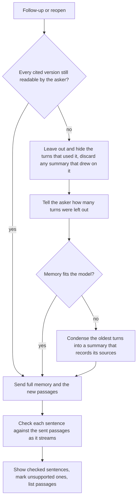
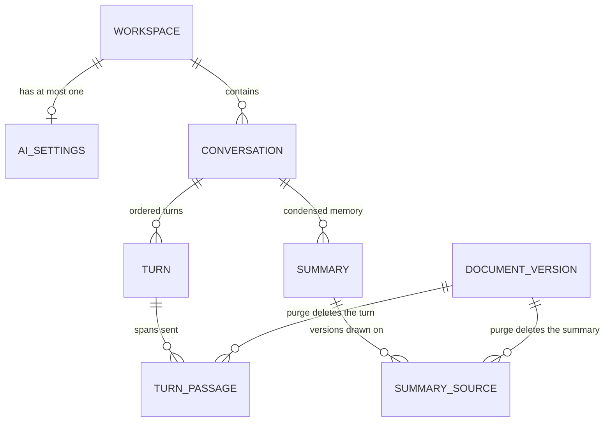

# Written Answers in Ask - Plan

## Goal Capsule

- **Objective:** In a workspace that has connected an AI provider, people get short written answers to their questions in Ask, every claim traceable to an approved document they may read or visibly marked as not supported, and can carry on the conversation, without any document text reaching a person or a model that may no longer see it.
- **Means:** an `httpx` streaming adapter for OpenAI-compatible Chat Completions behind a provider seam, sentence-by-sentence citation checks, and conversations stored as derivatives of the versions they cite (KTD1, KTD4, KTD6).
- **Product authority:** this Product Contract. It stays bound by the authorization plan (`docs/plans/2026-10-15-1207-feat-workspace-authorization-plan.md`: R18, R28, R33, AE9) and the ingestion plan (`docs/plans/2026-10-15-1737-feat-document-ingestion-rag-plan.md`: the bill of derivatives and purge receipts). Entity suggestions, the approval assistant and provider embeddings are not active scope.
- **Stop conditions:** stop and report if the policy property suite (`pytest -m property`) fails, if a turn's "versions sent" audit row cannot be committed before the provider call, or if a turn's text survives the purge of a version it cites.
- **Execution profile:** backend first (U1 to U6, then U9), then the UI (U7), then docs and the end-to-end check (U8). Build on the uncommitted Overview and `/search/history` work in the working tree; do not revert it.
- **Finishing:** `ce-work` implements and verifies locally; shipping goes through a reviewed PR on a feature branch that does not track `main` (see Documentation / Operational Notes).
- **Open blockers:** none.

---

## Product Contract

Product Contract preservation: changed — R2, R13, R15, R20, R23 and R29 refined, R26 to R31 added, the Outstanding Questions resolved and the citation-threshold assumption corrected, all from the planning-time scoping synthesis the user confirmed (streaming, two audit rows, purge on supersession, disconnect, settings visibility, rejected-key warning, retroactive retention, memory-only follow-ups). R1 to R31, A1 to A5, F1 to F3 and AE1 to AE8 keep their IDs.

### Summary

Ask on the Overview gains written answers, streamed sentence by sentence from an AI provider that a workspace's owners and admins connect with the workspace's own key. Each answer is built only from the passages the asker's search returned plus the conversation memory the currency check allows, and every sentence is citation-checked before it appears. Conversations are saved per person, private, resumable and expiring; every turn re-checks what it cites, and text built on a revision that stops serving is purged.

### Problem Frame

Ask today returns quoted passages from approved documents. During an incident a responder gets four or five passages from three documents and has to assemble the steps themselves, and cannot ask a follow-up such as "what about step 2?". The product's value is that agents and people get exactly what they may read, signed off by an approver, so a written answer is only worth having if it keeps that promise: no unmarked claim beyond approved text, no text the asker cannot read, and no text that outlives a withdrawal (authorization plan R18, AE9).

Two facts shape the risk. Anyone can create a workspace and so become its owner (`backend/app/routers/workspaces.py`), so any per-workspace setting is effectively set by any user. And a stored conversation is a new copy of text derived from documents, outside the policy filter that guards every other read.

### Actors

- A1. Operator: runs the deployment and decides which AI providers and models are offered.
- A2. Workspace owner or admin: connects the provider, enters the key, sets retention.
- A3. Asker: any workspace member using Ask.
- A4. AI provider: an OpenAI-compatible API chosen from the operator's list.
- A5. Agent over MCP: unchanged; named so its exclusion is explicit.

### Key Decisions

- **Written answers in Ask come first among the AI features.** (session-settled: user-directed — chosen over entity suggestions, the approval assistant and provider embeddings: it sends the least sensitive text and builds the provider layer the others reuse.)
- **Each workspace brings its own provider key, managed by its owners and admins.** Governs R2, R4, R5. (session-settled: user-directed — chosen over an operator-configured provider with owner opt-in, an operator provider on for everyone, and an operator default with owner override: per-workspace control, accepting that Lattice must store and protect a secret per workspace.)
- **Providers come only from an operator-curated list.** Governs R1, R3. (session-settled: user-directed — chosen over public HTTPS endpoints plus an operator allowlist, public endpoints only, and any URL: owners never enter a URL, so the server cannot be pointed at internal addresses.)
- **Full conversation memory, guarded by a per-turn currency check.** Governs R14, R15. (session-settled: user-directed — chosen over re-searching with earlier questions only and over standalone questions, then over amending authorization R18/AE9: natural follow-ups while withdrawn or hidden text still never comes back.)
- **Only currently serving text stays in a conversation.** Governs R15, R28. (session-settled: user-directed — chosen over keeping turns while any approved revision of the document is readable: an approved edit replaces the old text on purpose, and the UI and MCP keep one meaning of "readable".)
- **Long conversations are condensed into a summary that is discarded whole when any source goes.** Governs R16, R17. (session-settled: user-directed — chosen over leaving out the oldest turns and over ending a full conversation; discarding the whole summary keeps the currency guard exact, since one source cannot be removed from a blended summary.)
- **Conversations are stored on the server, per person, and resumable.** Governs R18. (session-settled: user-directed — chosen over keeping them in the open tab only and over shareable conversations.)
- **Owners and admins set retention, default 30 days, counted from the last turn.** Governs R20. (session-settled: user-directed — chosen over a fixed 30 days and over keeping conversations until deleted; counted from the last turn rather than the first so a conversation in use never expires mid-use.)
- **Conversations are private; the audit trail records each turn but not the answer.** Governs R19, R23. (session-settled: user-directed — chosen over manager-readable conversations and over storing answers in the audit trail: the append-only trail must not hold document-derived text that cannot be removed on withdrawal.)
- **Answers use checked citations.** Governs R8, R9, R10. (session-settled: user-directed — chosen over free answers with unchecked citations and over quotes with a one-line lead-in: every sentence shown is tied to approved text or marked as unsupported.)
- **Answers stream sentence by sentence.** Governs R26, R29. (session-settled: user-directed — chosen over a whole answer shown at once: answers appear sooner, and each sentence is still checked before it is shown.)
- **AI answers are off until a workspace connects a provider; failures fall back to passages; agents never get answers.** Governs R6, R13, R24. (session-settled: user-approved — proposed in the scoping synthesis with its consequences; accepted.)
- **Disconnect, settings visibility, the rejected-key warning, retroactive retention and memory-only follow-ups follow the planning synthesis.** Governs R20, R27, R30, R31. (session-settled: user-approved — proposed in the planning-time scoping synthesis; accepted.)

### Requirements

**Provider connection and workspace settings**

- R1. The operator lists the approved providers in deployment settings; each entry names an OpenAI-compatible endpoint and the models offered on it.
- R2. Workspace owners and admins connect AI answers by choosing an approved provider and model and entering the workspace's API key; members cannot change these settings.
- R3. Lattice sends AI requests only to the endpoint of the workspace's chosen approved provider.
- R4. The key is write-only: stored encrypted, never returned by any API or shown after entry, and replaceable or removable by any owner or admin, including after the person who entered it is demoted or removed.
- R5. Connecting, changing or removing the provider, model, key or retention period writes an audit row naming who changed what, never the key itself.
- R6. A workspace with no connected provider keeps today's quote-only Ask unchanged.
- R30. Every member sees whether AI answers are on and which provider and model are used, never the key; when the provider rejects the key, owners and admins see that in the AI settings.
- R31. When a workspace disconnects its provider, saved conversations stay readable until retention deletes them but cannot be continued.

**Answers**

- R7. Each answer is generated only from the passages that the asker's own permission-filtered search returned for that turn, plus the conversation memory R14 and R15 allow.
- R8. Every sentence in an answer cites a passage that was sent, and Lattice checks before showing it that each citation points at a sent passage and shares wording with that passage.
- R9. Sentences that fail the check are shown marked as not supported by the workspace's documents.
- R10. When no sentence passes the check, Ask shows "Your documents don't cover this" instead of an answer.
- R11. The passages behind every answer are shown beneath it, each with its document and approval, as Ask shows them today.
- R12. Lattice gives approved text to the model as quoted data kept apart from its instructions, and shows answer text only as plain text.
- R13. When the provider is unreachable, rejects the key or times out, Ask shows that turn's passages with the same short "answers are unavailable" notice for every cause, instead of an error.
- R26. Answers stream to the asker one checked sentence at a time; when no sentence has passed by the end, the streamed sentences are replaced by R10's message.
- R27. A follow-up whose search finds no new passages is answered from the passages carried in memory, and a question with neither new passages nor memory shows R10's message without calling the provider.

**Conversations and memory**

- R14. A follow-up sends the conversation's earlier questions, answers and passages to the model.
- R15. Before every follow-up and whenever a conversation is reopened, Lattice re-checks each cited version against the asker's current access, leaves out and hides every earlier turn that relied on text they can no longer read, and says only how many turns were left out.
- R16. When a conversation's memory no longer fits the chosen model, the model condenses the oldest turns into a summary that is sent in their place and records every version it drew on.
- R17. When any version a summary drew on stops being readable to the asker, Lattice discards the whole summary rather than editing it, and says so.
- R18. Conversations are saved per person and listed for that person to reopen and continue.
- R19. A conversation is visible only to the person who started it, whatever anyone else's role.
- R20. Owners and admins set a retention period between 1 and 365 days, default 30; a conversation is deleted automatically once that long has passed since its last turn, and a shorter period applies to existing conversations.
- R21. A person can delete any of their own conversations at any time.
- R22. Removing someone from the workspace deletes their conversations.
- R28. When a cited version stops serving, the existing purge deletes every saved turn and summary built on it and records them in its purge receipt.
- R29. When a cited version stops being readable while its turn is streaming, no further sentence is shown, the turn is not saved, and the asker sees "This answer was not saved because a document it used is no longer available to you" in its place.

**Audit, agents and product copy**

- R23. Each Ask turn writes two audit rows: the question, the versions sent, the provider and the model, committed before anything reaches the provider, then the outcome (answered, partly supported, not covered, provider failed, discarded, conversation changed, abandoned), never the answer text.
- R24. MCP is unchanged: agents receive retrieval results only, never generated answers (authorization R33).
- R25. The Overview's "Nothing is generated" line and PRODUCT.md's capability lists describe written answers truthfully, and the quote-only wording stays wherever no provider is connected.

### Key Flows

- F1. Connect a provider
  - **Trigger:** An owner or admin opens the workspace's AI settings.
  - **Actors:** A2, A1's provider list
  - **Steps:** Choose an approved provider and model; paste the key; save. Lattice checks the key with a request containing no workspace text, then stores it; the key is never shown again and the change is audited.
  - **Outcome:** Ask in this workspace starts answering in writing.
  - **Covered by:** R1, R2, R3, R4, R5, R30
- F2. Ask and get a checked answer
  - **Trigger:** An asker submits a question in Ask.
  - **Actors:** A3, A4
  - **Steps:** Lattice runs the asker's own search; records what it will send; streams the provider's answer, releasing each sentence once checked; re-checks the cited versions before saving the turn.
  - **Outcome:** An answer, a "not covered" result, or passages with a provider notice.
  - **Covered by:** R7, R8, R9, R10, R11, R12, R13, R23, R26, R27, R29
- F3. Follow up or reopen under the currency guard
  - **Trigger:** The asker sends a follow-up or reopens a saved conversation.
  - **Actors:** A3, A4
  - **Steps:** Re-check every cited version against current access; drop and hide turns built on text that is no longer readable, and discard any summary that drew on it; condense the oldest remaining turns if memory no longer fits the model; send the rest with the new question.
  - **Outcome:** The conversation continues with only text the asker may still read.
  - **Covered by:** R14, R15, R16, R17, R18, R31



### Acceptance Examples

- AE1. **Covers R15, R28.** **Given** Mei's conversation has an answer citing "Runbook: checkout payment timeouts", **when** its author withdraws it and Mei asks a follow-up, **then** the earlier turn is neither sent nor shown, Mei sees that one turn was left out, and the new answer cannot cite the runbook.
- AE2. **Covers R15, R18.** **Given** Sam saved a conversation citing "Incident 2026-09-14: checkout outage", **when** he is removed from the Payments group and reopens it, **then** the turns citing the incident report are hidden and the notice says how many.
- AE3. **Covers R8, R9, R10, R26.** **Given** an answer where one sentence shares no wording with the passage it cites, **when** it streams, **then** that sentence appears marked as not supported; **given** no sentence passes, **then** the streamed sentences are replaced by "Your documents don't cover this" and the passages.
- AE4. **Covers R6, R13, R30.** **Given** a workspace with no provider, **then** Ask behaves as today; **given** a connected provider that rejects the key, **then** the turn shows its passages with the "answers are unavailable" notice and owners and admins see the rejected key in the AI settings.
- AE5. **Covers R4, R5.** **Given** Arjun connected the key and is later demoted to member, **when** Olivia replaces the key, **then** answers keep working throughout, both changes appear in the audit trail, and neither audit row contains the key.
- AE6. **Covers R19, R23.** **Given** Mei asked three questions today, **when** Olivia reads the audit trail, **then** she sees each question, the versions sent and the outcome, but no answer text, and no role lets her open Mei's conversation.
- AE7. **Covers R24.** **Given** Arjun's agent searches over MCP in a workspace with a connected provider, **then** it receives the same retrieval results as before and no generated answer.
- AE8. **Covers R16, R17.** **Given** Mei's long conversation has a summary built partly from "Runbook: checkout payment timeouts", **when** that runbook is withdrawn and Mei asks a follow-up, **then** the whole summary is discarded, Mei is told, and neither the summary nor the runbook's text is sent.

### Success Criteria

- On the synthetic benchmark corpus, no answer shows an unmarked sentence that its cited passage does not support, judged on a hand-checked sample.
- A responder can act on an answer to a runbook question without opening the documents, and can open the cited passage in one step when they want to check it.

### Scope Boundaries

**Deferred for later**

- Entity suggestions, the approval assistant and provider embeddings (see How This Work Fits Together).
- Per-person or per-workspace usage limits; cost sits on the workspace's key, and Lattice has no rate limiting yet.
- An operator UI for the provider list; it stays in deployment settings.
- Sharing conversations with teammates.
- A cloud key-management service for the master key; v1 keeps it in `.env` (KTD2).

**Outside this product's identity**

- A general chatbot: answers draw only on the asker's approved, readable passages, never on the model's own knowledge.
- Generated answers over MCP: agents bring their own models and keep getting evidence (R24).

**Considered and not built**

- Retries for a failed provider call. A failure already falls back to passages (R13); retries would hold an asker for seconds during an incident. Revisit if providers show frequent transient 429s.
- An entailment verifier on top of the wording check. It would add a second model call per sentence; revisit if the Success Criteria sample finds unmarked unsupported sentences.
- Dropping, rather than marking, sentences that fail the check. Research recommends it, since a marked sentence still states something no approved text says; R9 keeps the user's choice to show them marked.

<!-- ce-section: work-relationships -->
### How This Work Fits Together

This plan covers written answers in Ask. The breakdown below is the current understanding, not a committed roadmap.

- Entity suggestions: the model proposes entities and aliases from approved documents for managers to accept.
  - Depends on the provider connection from R1 to R5.
  - Shares R12's rule that document text is data, never instructions.
  - Still to decide: how it beats the deterministic registry on the benchmark, as the ingestion plan requires.
- Approval assistant: a summary of what a draft changes, for reviewers.
  - Depends on the provider connection from R1 to R5.
  - Still to decide: whether unapproved drafts, the riskiest text for hidden instructions, may be sent at all.
- Provider embeddings: search vectors from the provider instead of the local model.
  - Can proceed independently of this plan.
  - Still to decide: the re-index and re-tuning it forces, and sending every indexed version, drafts included, to the provider.

### Dependencies / Assumptions

- The operator has access to at least one provider exposing an OpenAI-compatible chat API with streaming.
- A hand-labeled set of answer sentences and their cited passages, built from the synthetic corpus, can tune the citation check's threshold (U5); the benchmark measures retrieval, not sentence support.
- Removing a member already deletes their group memberships and revokes their tokens (authorization plan, Assumptions); R22 extends that to conversations.

### Sources / Research

- `backend/app/embedding.py`: the `Embedder` protocol with a real and a fake implementation, the pattern the provider seam follows.
- `backend/app/routers/search.py`: the permission-filtered search and its audit row that each Ask turn builds on.
- `backend/app/audit.py`: the rule that audit detail never carries document text.
- `backend/app/mcp_server.py`: the two retrieval tools that stay unchanged; `_evidence` is the per-version access check the guard reuses.
- `backend/app/derived.py`: the bill of derivatives and purge receipts R28 extends.
- `frontend/src/pages/Overview.vue`: the current Ask panel and its "Nothing is generated" line.
- `PRODUCT.md`: the capability lists R25 updates.

---

## Planning Contract

### Key Technical Decisions

- KTD1. **A provider seam modeled on the embedder.** A `ChatProvider` protocol with an `httpx` OpenAI-compatible streaming implementation and a deterministic fake, selected per operator provider entry, as `Embedder`/`FakeEmbedder`/`make_embedder` are (`backend/app/embedding.py`). No OpenAI SDK: `httpx` 0.28.1 is already locked, and several servers are only "compatible" ([vLLM](https://docs.vllm.ai/en/latest/serving/online_serving/openai_compatible_server/), [Ollama](https://docs.ollama.com/openai)). Each operator entry is a typed record (id, label, base URL, auth header kind, offered models with context and output limits); the provider list and the fake kind are JSON in `LATTICE_AI_PROVIDERS`.
- KTD2. **The master encryption key lives in `.env`.** Workspace keys are encrypted with AES-GCM from `cryptography`, a fresh nonce per encryption, and the workspace and provider ids bound as associated data, so a ciphertext copied to another workspace fails. The key list is `LATTICE_AI_KEY_ENCRYPTION_KEYS` in `.env` or the environment, newest first; older entries only decrypt, which allows rotation. Startup refuses a configured provider list without a valid key, as it refuses the dev pepper (`backend/app/main.py`). Because the provider id is bound in, changing the provider requires entering a new key in the same save. Governs R4. (session-settled: user-directed — chosen over a cloud key-management service: the deployment's `.env`, like the existing secret pepper.)
- KTD3. **Policy actions, not service checks.** New `Action`s: `ask` (any member), `manage_own_conversations` (any member, scoped to their own rows in the query, like `searches.own`), `view_ai_settings` (any member) and `manage_ai_settings` (owner or admin). `decide` already denies all of them on the MCP channel. The currency guard is one query over the cited version ids with `read_clause(subject, Action.RETRIEVE, …)`, so it has exactly the read rule MCP's `get_evidence` applies (`backend/app/policy.py`, `backend/app/mcp_server.py`). No read rule changes, so the property suite stays as it is.
- KTD4. **Conversations are derivatives of the versions they cite, purged whole.** Each turn records the spans it sent (document, version, start, end, sha256), and each summary its source versions, in tables with a composite key to `document_versions` like `version_decisions`. The bill of derivatives gets a turn-level rule: `purge_document` deletes every turn and summary with any stale passage or source row, the rows cascading, registered before the passage tables as the file already orders `chunks` and `derivations`; their counts join the receipt (R28), and each affected conversation's left-out count is increased, so the next reopen or follow-up shows R15's and R17's notices for text the purge removed, then the count resets. Passage text is never copied: version bodies are immutable, so memory re-reads the spans. Governs R14, R16, R28.
- KTD5. **A turn runs in three steps, with no transaction held across the provider call.** Governs R23, R29.
  1. In the request transaction: authorize, mark the conversation's turn in flight (KTD10), run the guard, search, and write the "sent" audit row; the request session commits as the handler returns its streaming response, before the stream starts. Never commit the request session inside the handler; if the installed FastAPI tears the dependency down only after the stream ends, step 1 uses its own session instead, and U9's ordering test decides which.
  2. With no open transaction: stream from the provider; before releasing each sentence, reload the asker's live subject and re-check the cited versions in a short session, and on any loss cancel the stream and send the discarded event.
  3. In a fresh session: reload the subject, take `FOR SHARE` on every cited document row in ascending id order (the discipline `derive.sweep` and `derive.derive` already use), re-check under that lock, then write the turn, any summary from step 2, and the outcome row. A purge that starts afterwards waits on the lock and then deletes the committed turn.
  4. On any failure in step 3, roll back and write the outcome row ("discarded" or "conversation changed") in a new transaction, so every "sent" row has exactly one outcome row.
  5. A client disconnect or Stop cancels the stream; a shielded cleanup writes the "abandoned" outcome and clears the in-flight mark, and the retention sweep (KTD11) does the same for any mark older than the turn timeout.
  6. A member removed mid-turn is handled by the conversation foreign key: the turn insert blocks the parent delete, and the cascade removes the committed turn.
- KTD6. **Citations are inline markers, checked one sentence at a time.** The model writes one sentence per line ending in markers such as `[P2]`; each passage sent this turn, including those carried in memory, gets a short id. A sentence passes when every marker names a sent passage, its content words overlap that passage's by at least a threshold tuned on U5's labeled set, and it carries the same number of negation words (not, no, never, without and the like) as the cited passage, so an inverted step fails. JSON structured output is not used, because it cannot be checked until it is complete. Governs R8, R9, R26.
- KTD7. **Server-sent events over a POST stream.** The turn route returns `text/event-stream`; the browser reads it through `fetch` (which keeps the CSRF header and Origin check) rather than `EventSource`, which cannot POST. `GuardMiddleware` is plain ASGI, so it does not buffer the stream, and the CSP's `connect-src 'self'` allows it. Events carry passages, checked sentences, a replace-with-not-covered instruction, notices and the final outcome.
- KTD8. **The prompt treats everything but its own rules as data, and gives the model no tools.** One system message states the rules; passages, earlier answers and summaries all go in delimited records marked as data, never as instructions; requests carry no `tools`. Answer text renders as plain text through the existing text-only components, with no automatic links or images. The wording check (KTD6) does not detect injected wording copied from an approved passage; no tools, plain text and the asker's own read access bound what that can do. Governs R12. Source: [OpenAI prompt-injection guidance](https://openai.com/safety/prompt-injections/).
- KTD9. **One attempt per turn, and failures map to stable outcomes.** The client never follows redirects, and the auth header kind is a closed set (bearer or `api-key`), so the key cannot be sent anywhere but the listed endpoint. Connect, read and pool timeouts are explicit; a 401 marks the workspace key as rejected (shown to managers, R30); every other failure, including malformed output and responses after the timeout, is "provider failed". Askers see one notice for every cause (R13). Saving a new key, provider or model sends one request with a fixed prompt and no workspace text, so a bad key or model is caught then, not by the first asker; a retention-only save calls no provider.
- KTD10. **One turn in flight per conversation.** Step 1 locks the conversation row, refuses the turn with "An answer is already in progress" when a fresh in-flight mark exists, and otherwise sets the mark with its turn number; step 3 or the cleanup clears the mark only when that number still matches, and a mark older than the turn timeout (the provider read timeout plus 30 seconds) counts as clear. Turn numbers stay unique per conversation as a backstop. This prevents two tabs streaming into one conversation; it does not cap spend, which stays uncapped until the deferred usage limits ship. Lock order everywhere: documents, then conversations, then turns, added to the lock-order comments in `backend/app/services/derive.py` and `backend/app/derived.py`.
- KTD11. **Retention runs in a sweep next to the derivation worker.** A periodic task started in the app lifespan deletes conversations past their workspace's retention; reads also treat an expired conversation as absent, so nothing reappears between sweeps.
- KTD12. **Memory is budgeted by an estimate before each call.** Lattice estimates prompt size from character counts against the chosen model's configured context, keeping room for the answer; when over, step 2 condenses the oldest turns in one non-streaming call with no open transaction, and step 3 saves the summary and its sources under KTD5's lock, discarding it if any source stopped serving during the call (KTD4).
- KTD13. **Ask turns stay in "Your last 10 queries".** Ask questions already appear there today (`via=ask`); the history route includes `ask` audit rows as source "Ask" only while their conversation still exists, so a deleted or expired conversation also leaves the asker's own history, and choosing one reopens that conversation.
- KTD14. **Routes, checks and errors follow the existing API edge.** Every new route lives under `/api/workspaces/{workspace_id}/`, so `GuardMiddleware`'s Origin, CSRF and bearer refusal apply, and takes the `Member` subject. The key is validated in the service, never in the request schema, so FastAPI's default 422 body, which echoes submitted input, can never contain it.
- KTD15. **The development master key follows the pepper's rule.** Startup refuses the published development key whenever development cookies are off, exactly as it refuses `DEV_PEPPER`; `compose.yaml` labels both as development-only. A stricter rule would break `make start`, whose stack already runs with development cookies.

### High-Level Technical Design

A streaming turn, across the three steps of KTD5:

```mermaid
sequenceDiagram
  participant B as Browser (Overview)
  participant R as Turn route
  participant DB as PostgreSQL
  participant P as AI provider
  B->>R: POST question (session cookie, CSRF)
  R->>DB: authorize, mark the conversation in flight, currency guard on memory, search
  R->>DB: audit row "sent" (question, versions, provider, model); committed as the response starts
  R-->>B: event: passages
  R->>P: streamed chat completion (passages as data, no tools)
  loop each completed sentence
    P-->>R: tokens
    R->>R: check markers and wording against sent passages
    R->>DB: short session: reload subject, re-check cited versions
    R-->>B: event: sentence (supported or marked)
  end
  R->>DB: new session: reload subject, FOR SHARE on cited documents, re-check, save turn, audit row "outcome", clear the in-flight mark
  alt a cited version is no longer readable, or the conversation is gone
    R-->>B: event: discarded (notice)
  else no sentence passed
    R-->>B: event: not covered (replace streamed text)
  else
    R-->>B: event: done
  end
```

What is stored, and what the purge removes:



`AI_SETTINGS` holds the provider id, model, encrypted key, key status and retention days. `TURN` holds the question, the checked sentences with their markers and support flags, the outcome, the provider and the model. `TURN_PASSAGE` and `SUMMARY_SOURCE` carry the document and version ids that drive KTD4's turn-level purge. `CONVERSATION` carries the in-flight mark (KTD10), the left-out count (KTD4) and the last-turn time used by retention.

### Assumptions

- The provider entries the operator lists support streaming Chat Completions with `stream: true` and server-sent `data:` lines; entries that do not are not offered.
- A character-based token estimate with a safety margin is close enough for budgeting (KTD12); a provider's own token count is not available before the call.

### Sequencing

U1 and U2 have no dependencies on each other. U3 depends on U1 (settings) for the key columns. U4 depends on U1, U2 and U3. U5 depends on U2 and U3. U6 depends on U4 and U5. U9 depends on U5 and U6. U7 depends on U4, U6 and U9. U8 depends on all of them.

---

## Implementation Units

### U1. Provider list, key encryption and startup checks

- **Goal:** Lattice reads the operator's provider list and master keys from settings, encrypts and decrypts workspace keys, and refuses to start when providers are configured without a valid key.
- **Requirements:** R1, R3, R4; KTD1, KTD2, KTD15.
- **Dependencies:** none.
- **Files:**
  - `backend/app/config.py` (provider list and key-list settings)
  - `backend/app/ai/__init__.py`, `backend/app/ai/keys.py` (encrypt, decrypt, rotation)
  - `backend/app/main.py` (startup refusal)
  - `backend/pyproject.toml`, `backend/uv.lock` (`cryptography` as a direct dependency)
  - `.env.example` (documented `LATTICE_AI_PROVIDERS` and `LATTICE_AI_KEY_ENCRYPTION_KEYS`)
  - `backend/tests/test_ai_keys.py`, `backend/tests/test_config.py`
- **Approach:**
  1. Add typed provider records and the key list to `Settings`; validate unique ids, HTTPS base URLs except for the fake kind, at least one model per entry, and 32-byte keys.
  2. Implement encrypt and decrypt with a key-version prefix so older keys still decrypt.
  3. Refuse startup when providers are listed and no valid key is set, and refuse the published development key when development cookies are off (KTD15).
- **Patterns to follow:** `Settings` and `DEV_PEPPER` refusal in `backend/app/config.py` and `backend/app/main.py`; `SecretStr` for the key list.
- **Test scenarios:**
  - Encrypting then decrypting a key with the same workspace and provider returns it.
  - Decrypting with another workspace id or provider id fails.
  - A ciphertext with one changed byte fails.
  - A key encrypted under the old master key decrypts after a new key is listed first, and new encryptions use the new key.
  - Two encryptions of the same key produce different ciphertexts.
  - Settings with providers and no master key refuse to start; settings with neither start.
  - The published development key is refused with development cookies off and accepted with them on.
  - A provider entry with a plain HTTP base URL is rejected unless it is the fake kind.
  - Duplicate provider ids are rejected.
- **Verification:** the key round trip and refusal tests pass, and `repr(settings)` shows none of the new key fields (the existing plain-string pepper is out of scope).

### U2. Streaming chat provider and fake

- **Goal:** Lattice can stream a chat completion from an operator-listed provider, or from a deterministic fake, and classify every failure.
- **Requirements:** R3, R12, R13; KTD1, KTD8, KTD9.
- **Dependencies:** none.
- **Files:**
  - `backend/app/ai/provider.py` (protocol, OpenAI-compatible client, fake, factory)
  - `backend/tests/test_ai_provider.py`
- **Approach:**
  1. Define the protocol: stream text for a message list, and one short non-streaming completion for condensing and the key check.
  2. Implement the client over a shared `httpx.AsyncClient` with explicit timeouts and limits, the entry's auth header kind, `stream: true`, and parsing of `data:` lines up to `[DONE]`.
  3. Map 401 to key rejected; map other HTTP errors, transport errors, timeouts and malformed streams to provider failed.
  4. Implement the fake: it answers from the passages it is given with valid markers, and test hooks make it emit an unsupported sentence, fail, or stall.
- **Patterns to follow:** `FastEmbedder` / `FakeEmbedder` / `make_embedder` in `backend/app/embedding.py`.
- **Test scenarios:**
  - With `httpx.MockTransport`, a streamed response in three chunks yields the full text in order.
  - The request goes to the entry's base URL with its auth header and carries no `tools` field.
  - A 302 to another host is not followed, the key is not resent, and the call is provider failed.
  - A 401 is classified as key rejected; 429, 500 and a connection error are provider failed.
  - A stream that stops before `[DONE]` is provider failed.
  - A read timeout is provider failed.
  - The fake, given two passages, cites only those passage ids.
- **Verification:** no test reaches the network, and the key never appears in a log line or exception message.

### U3. Schema, policy actions, purge and member removal

- **Goal:** settings, conversations, turns and summaries exist in the database with least-privilege grants, the policy knows the new actions, and purge and member removal delete conversation text.
- **Requirements:** R19, R20, R22, R28; KTD3, KTD4, KTD10.
- **Dependencies:** U1.
- **Files:**
  - `backend/app/migrations/versions/0004_ai_answers.py`
  - `backend/app/models.py`
  - `backend/app/policy.py`
  - `backend/app/derived.py`
  - `backend/app/services/workspaces.py`
  - `backend/tests/test_schema.py`, `backend/tests/test_policy.py`, `backend/tests/test_purge.py`, `backend/tests/test_workspaces.py`
- **Approach:**
  1. Create the six tables of the data-model diagram, with a unique turn number per conversation, cascades from workspace and conversation, composite document-and-version keys on the passage and source tables (KTD4), and the in-flight mark and left-out count on conversations.
  2. Grant `lattice_app` `SELECT`, `INSERT` and `DELETE` on the conversation, turn, summary, passage and source tables, and `UPDATE` only on settings and conversations; add a reject-modification trigger on turns and summaries, as 0001 does for `document_versions`.
  3. Add the four actions and their rules (KTD3), branched in `_rule_for` before its document assertion, so a call without a document is decided rather than raising.
  4. Register the turn-level rule and the passage and source tables in the bill of derivatives (KTD4), and widen the schema guard to the foreign-key closure from `document_versions`, so a text-holding table that references a derived table is caught too.
  5. Delete the removed member's conversations inside `remove_member`, in the same transaction, and add conversations and turns to the lock-order comments (KTD10).
- **Patterns to follow:** grants and forward-only `downgrade` in `backend/app/migrations/versions/0001_initial_schema.py`; `DERIVED_TABLES` in `backend/app/derived.py`; guarded deletes in `backend/app/services/workspaces.py`.
- **Test scenarios:**
  - The bill-of-derivatives guard passes with the new tables registered.
  - The widened guard flags a test table that has no direct version key but references a registered derived table.
  - `lattice_app` has exactly the planned privileges on each new table, owns none of them, and cannot update a turn or summary.
  - `lattice_app` cannot update or delete audit rows (existing test still passes) and owns none of the new tables.
  - Covers AE1. Withdrawing a document deletes a turn citing it, the purge receipt counts that turn, and the conversation's left-out count rises by one.
  - Approving a new version of a cited document deletes turns and summaries citing the old version.
  - A turn citing one purged and one still-serving version is deleted whole.
  - Removing a member deletes their conversations and leaves other members' conversations.
  - Owner and admin may `manage_ai_settings`; members may not; every member may `ask`, `view_ai_settings` and `manage_own_conversations`; all four are denied on the MCP channel, and none raises on the UI channel without a document.
  - Two turns with the same number in one conversation are rejected by the database.
- **Verification:** the migration applies on a fresh database, the schema and policy suites pass, and `pytest -m property` passes unchanged.

### U4. AI settings API

- **Goal:** owners and admins connect, change and disconnect the provider, model, key and retention; every member can see whether AI is on.
- **Requirements:** R2, R4, R5, R6, R20, R30, R31; KTD2, KTD9; F1; AE4, AE5.
- **Dependencies:** U1, U2, U3.
- **Files:**
  - `backend/app/routers/ai.py`
  - `backend/app/main.py` (register the router)
  - `backend/tests/test_ai_settings.py`
  - `backend/tests/test_endpoint_matrix.py`, `backend/tests/endpoint_grounds.py`
- **Approach:**
  1. `GET` returns the operator's providers and models, whether AI is on, the chosen provider and model, retention days, and, for managers only, the key status; it never returns the key.
  2. `PUT` accepts provider, model, retention and an optional new key, validated in the service (KTD14); a provider change needs a new key (KTD2), and a shorter retention needs a confirmed count of the conversations it deletes; a new key is checked with one fixed-prompt request (KTD9) and refused when rejected; the audit row records what changed and whether the key was replaced, never the key.
  3. `DELETE` disconnects, removing the encrypted key; conversations stay (R31).
- **Patterns to follow:** `authorize` then `record` in `backend/app/routers/workspaces.py`; manager-only actions in `backend/app/policy.py`.
- **Test scenarios:**
  - Covers AE5. An admin connects a key; after the admin is demoted, the owner replaces it; answers keep working, and neither audit row contains the key.
  - A member's `PUT` is refused as not found and changes nothing.
  - A `GET` by a member shows the provider and model and no key status; by an admin, it shows the key status.
  - A key the provider rejects on save is not stored, and the response says it was rejected.
  - Changing the provider without a new key is refused; with a new key it is checked and stored.
  - Shortening retention returns how many conversations it would delete and saves only when the request confirms that count, which the audit row records.
  - Choosing a provider or model not in the operator list is refused.
  - Retention outside 1 to 365 days is refused.
  - A `PUT` with a malformed body that includes a key returns an error body that does not contain the key.
  - `DELETE` removes the encrypted key and keeps saved conversations.
  - Every route has an endpoint-matrix case for every actor, grounded against the database.
- **Verification:** the endpoint coverage guard passes, and no response body or audit row in the suite contains the test key.

### U5. Answering core: prompt, citation check, guard and condensing

- **Goal:** given an asker, a conversation and a question, Lattice builds the guarded memory and prompt, checks streamed sentences, and condenses memory when needed.
- **Requirements:** R7, R8, R9, R10, R12, R14, R15, R16, R17, R27; KTD3, KTD6, KTD8, KTD12.
- **Dependencies:** U2, U3.
- **Files:**
  - `backend/app/ai/answering.py` (guard, memory, prompt, condensing)
  - `backend/app/ai/citations.py` (sentence splitting, marker parsing, wording check)
  - `backend/tests/test_citations.py`, `backend/tests/test_answering.py`
  - `backend/tests/data/citation_labels.json` (hand-labeled supported and unsupported sentences with their cited passages, from the synthetic corpus)
- **Approach:**
  1. Guard: one query over every version cited by the conversation's turns and summary with the `RETRIEVE` read clause; hide turns with an unreadable version, delete a summary with an unreadable source, and return the count left out.
  2. Memory: rebuild each surviving turn's passages from the immutable version bodies by span; give every sent passage a short id.
  3. Prompt: the system rules, delimited passage records and the question (KTD8).
  4. Condense when the estimate exceeds the model's budget (KTD12).
  5. Citation check per completed sentence (KTD6); expose it as a pure function over a sentence and the sent passages, and set its threshold and stopwords so that no labeled unsupported sentence passes.
  6. Add the purge's recorded left-out count to the guard's own count, then reset it (KTD4).
- **Execution note:** implement the citation check test-first; it carries the product's main promise.
- **Patterns to follow:** `read_clause` use in `backend/app/services/search.py`; `_evidence` in `backend/app/mcp_server.py`.
- **Test scenarios:**
  - A sentence citing a sent passage it shares wording with passes.
  - A sentence citing an id that was never sent fails.
  - A sentence with no marker fails.
  - A sentence whose only shared words are stopwords fails.
  - "Fail over the primary while replication lag exceeds 5 s" cited to "Do not fail over the primary while replication lag exceeds 5 s" fails.
  - Every labeled unsupported sentence fails and at least the agreed share of labeled supported sentences pass.
  - A sentence citing a passage carried in memory passes.
  - Covers AE3. Given every sentence fails, the check reports not covered.
  - Covers AE1. After the cited document is withdrawn and purged, the next follow-up reports one turn left out from the recorded count, and a second follow-up reports none.
  - Covers AE2. After the asker leaves the group the document is shared with, the guard hides its turns.
  - Covers AE8. A summary with one withdrawn source is deleted whole and the next follow-up reports it.
  - A follow-up with no new passages builds a prompt from memory; a first question with no passages produces no provider call.
  - Passage text containing "ignore previous instructions" stays inside its delimited record and the system message is unchanged.
  - An earlier answer and a summary are sent as delimited data records, not as instructions.
  - Memory over the budget triggers one condensing call, and the summary records every source version.
- **Verification:** the guard's result for every fixture matches `get_evidence` for the same subject and version.

### U6. Conversations API: create, list, read, delete and retention

- **Goal:** askers create, list, reopen and delete their own conversations, expired conversations disappear, and Ask turns show up in the query history.
- **Requirements:** R15, R18, R19, R20, R21, R31; KTD3, KTD11, KTD13; F3; AE2.
- **Dependencies:** U4, U5.
- **Files:**
  - `backend/app/routers/conversations.py`
  - `backend/app/routers/search.py` (history includes Ask turns)
  - `backend/app/ai/retention.py`
  - `backend/app/main.py` (register the router; start the retention sweep)
  - `backend/tests/test_conversations.py`
  - `backend/tests/test_endpoint_matrix.py`, `backend/tests/endpoint_grounds.py`
- **Approach:**
  1. Routes: create, list own, read one (guarded view with the left-out count from U5), and delete; every query is scoped to the asker's own rows.
  2. Expired conversations read as absent, and the sweep deletes them (KTD11).
  3. History: include `ask` audit rows as source "Ask" while their conversation exists (KTD13).
- **Patterns to follow:** the own-rows query of `/search/history` in `backend/app/routers/search.py`; the derivation worker's lifespan task in `backend/app/main.py`.
- **Test scenarios:**
  - Covers AE2. Reopening a conversation after the asker leaves the sharing group returns the remaining turns and a left-out count with no document name.
  - Another member's conversation id reads as not found for read and delete.
  - An owner cannot read a member's conversation.
  - A conversation past retention reads as not found, and the sweep deletes it.
  - Shortening retention from 30 to 1 day makes a conversation idle for 2 days read as not found.
  - After disconnect, a saved conversation can still be read.
  - An Ask turn appears in `/search/history` as source "Ask", and disappears once its conversation is deleted.
  - Deleting one's own conversation removes it and all its turns, summaries and passage rows.
  - Every route has an endpoint-matrix case for every actor, grounded against the database.
- **Verification:** the endpoint coverage guard passes.

### U9. Streaming turns

- **Goal:** each Ask turn streams checked sentences to the asker under the three-step flow, with both audit rows, and is saved only if what it cites is still readable.
- **Requirements:** R7, R11, R13, R23, R24, R26, R27, R29, R31; KTD5, KTD7, KTD9, KTD10; F2; AE4, AE6, AE7.
- **Dependencies:** U5, U6.
- **Files:**
  - `backend/app/routers/conversations.py` (the turn route)
  - `backend/tests/test_turns.py`, `backend/tests/test_mcp.py`
  - `backend/tests/test_endpoint_matrix.py`, `backend/tests/endpoint_grounds.py`
- **Approach:**
  1. Follow KTD5's three steps and KTD10's claim; emit events per KTD7.
  2. Release each sentence only after U5's check and the per-sentence access re-check.
  4. With no connected provider, the route is refused and the UI keeps quote-only Ask (R6).
- **Patterns to follow:** `search_documents` in `backend/app/routers/search.py`; `sessionmaker` use in `backend/app/mcp_server.py`.
- **Test scenarios:**
  - A turn with the fake provider streams passages, then sentences, then done, and saves the turn.
  - The "sent" audit row exists before the fake provider receives its first request.
  - Covers AE6. The two audit rows hold the question, versions sent, provider, model and outcome, and no answer text.
  - A document withdrawn after the second sentence: no third sentence is sent, the stream is cancelled, a discarded event follows, and no turn is saved.
  - Removing the asker from the sharing group mid-stream discards the turn.
  - A withdrawal that commits during step 3's window leaves no turn row once the purge has run.
  - Every "sent" audit row has exactly one outcome row, including when step 3 fails.
  - The fake provider failing mid-stream shows the passages and the "answers are unavailable" notice, and records provider failed.
  - Covers AE4. A key rejected mid-turn marks the key status rejected and askers see only the generic notice.
  - Two turns posted at once to one conversation: one runs, the other gets "An answer is already in progress" before the fake provider receives a request.
  - Dropping the connection after the second sentence writes one "abandoned" outcome row and clears the in-flight mark.
  - A stale in-flight mark older than the turn timeout does not block the next turn, and a turn's cleanup never clears a newer turn's mark.
  - Deleting a conversation during a turn discards the turn.
  - A first question with no passages shows "Your documents don't cover this" and the fake provider receives no request.
  - After disconnect, a new turn on a saved conversation is refused.
  - Covers AE7. MCP `search_knowledge` returns the same results with a provider connected, and `tools/list` is still exactly two tools.
  - The turn route has an endpoint-matrix case for every actor that grounds both audit rows.
- **Verification:** no test holds a database transaction while the fake provider is streaming.

### U7. AI settings page and streaming Ask with conversations

- **Goal:** managers configure AI in a settings page; askers see streamed, checked answers with their passages, resume saved conversations, and see notices for left-out turns.
- **Requirements:** R6, R9, R10, R11, R15, R18, R21, R25, R26, R30, R31; KTD7.
- **Dependencies:** U4, U6, U9.
- **Files:**
  - `frontend/src/api.ts` (a streaming POST helper that keeps the CSRF header)
  - `frontend/src/pages/AiSettings.vue`
  - `frontend/src/pages/Overview.vue`
  - `frontend/src/router.ts`, `frontend/src/pages/WorkspaceLayout.vue` ("AI answers" under Governance)
  - `frontend/src/pages/pages.test.ts`, `frontend/src/api.test.ts`
- **Approach:**
  1. Settings page: provider and model selects from the operator list, a password-type key field that is cleared after saving, retention, disconnect, and the rejected-key warning.
  2. Overview: when AI is on, Ask posts turns and renders events as they arrive; marked sentences carry a visible "not supported by your documents" label; a not-covered event replaces the streamed text; passages render as today.
  3. A discarded event replaces the streamed sentences with R29's notice; a dropped summary shows "Earlier context was dropped because a document it drew on is no longer available to you"; neither names a document.
  4. While a turn is in flight the composer and history buttons are disabled with "Answering…" and a Stop control aborts the stream; a conversation in a disconnected workspace shows "AI answers are off for this workspace, so this conversation is read-only" instead of the composer.
  5. A conversation list for reopening and deleting saved conversations sits beside "Your last 10 queries", stacked above it on narrow screens; choosing an Ask row in the history reopens its conversation; a reopened conversation shows the left-out notice.
  6. Settings: shortening retention shows the number of conversations it will delete and saves only after confirmation, using the existing `window.confirm` pattern.
  7. Copy: the footer says what is true for the workspace's state (R25).
- **Patterns to follow:** `useLoad` and `useAction` in `frontend/src/session.ts`; `Snippet.vue` for text-only rendering; the CSP rule of no inline styles.
- **Test scenarios:**
  - With AI off, Ask behaves as today and the footer keeps the quote-only wording.
  - Streamed sentence events appear in order before the done event.
  - A marked sentence shows the "not supported" label.
  - A not-covered event replaces the streamed sentences with "Your documents don't cover this".
  - A sentence containing HTML renders as text.
  - Reopening a conversation with two left-out turns shows the count and no document name.
  - A discarded event replaces the streamed sentences with the not-saved notice.
  - While a turn streams, the composer is disabled and Stop aborts the request.
  - Choosing an Ask row in the history opens its conversation.
  - A member sees the provider and model but no settings form; an admin sees the form and the rejected-key warning.
  - The key field is empty after a successful save.
- **Verification:** unit tests, lint and the type-checked build pass, and the page is checked at desktop and mobile widths with no console or CSP errors.

### U8. Product docs, development defaults and end-to-end check

- **Goal:** the product docs describe written answers truthfully, local development runs with the fake provider, and one browser test proves the whole flow.
- **Requirements:** R25; F1, F2, F3.
- **Dependencies:** U1 to U7, U9.
- **Files:**
  - `PRODUCT.md`, `README.md`
  - `compose.yaml` (development-only fake provider and a development master key, both labelled as such)
  - `frontend/e2e/app.spec.ts`
- **Approach:**
  1. Move written answers into PRODUCT.md's implemented capabilities, keep entity suggestions, the approval assistant and provider embeddings in "not built", and update the README status table.
  2. Give the development stack a fake provider and a development master key, so `make start` exercises the feature without a real provider.
- **Test scenarios:**
  - An admin connects the fake provider, Mei asks a question and sees streamed sentences with passages, asks a follow-up, and finds the conversation in her list after a reload, with no console or CSP errors.
- **Verification:** `make e2e` passes against `make start`.

---

## Verification Contract

| Gate | Command | Proves |
|---|---|---|
| Backend fast suite | `cd backend && uv run pytest -m "not property and not benchmark_model" -q` | U1 to U6 and U9 behavior, endpoint matrix and coverage guard |
| Policy properties | `cd backend && uv run pytest -m property -q` | the read rules and channels are unchanged (KTD3) |
| Frontend unit | `cd frontend && npm test` | U7 rendering and stream handling |
| Lint and build | `make lint` | ruff, frontend lint and the type-checked build |
| End to end | `make start && make e2e` | U8 flow on the Docker stack with the fake provider |
| Benchmark | `cd backend && uv run pytest -m benchmark -s` | the existing retrieval and lifecycle gates still hold (the KTD6 threshold is proven by U5's labeled set in the fast suite) |

## Definition of Done

- Every gate in the Verification Contract passes.
- Every R1 to R31 and AE1 to AE8 is covered by a named test or check in a unit.
- No test, log line, response body or audit row contains a workspace API key.
- No test calls a real AI provider.
- The PRODUCT.md and README capability lists match what shipped.
- Code from abandoned approaches is removed from the diff.

## System-Wide Impact

- **Data lifecycle:** conversation text joins the bill of derivatives, so every withdrawal and approval now also purges conversation turns (R28); receipts grow two counts.
- **Audit:** turns write two rows, the first before any data leaves the server; the append-only rules are unchanged.
- **Agent parity:** MCP's tool list and results are unchanged (R24); the guard reuses MCP's read rule, so the two channels agree on what is readable.
- **Operations:** deployments that list providers need a master key in `.env`; rotating it means listing the new key first, having each owner or admin re-save their workspace's key, and removing the old master key only once no stored key still depends on it.

## Risks & Dependencies

| Risk | Mitigation |
|---|---|
| A provider streams formats that differ from OpenAI's | Operator entries are curated, and U2 tests the parser against chunked, partial and malformed streams |
| The wording check passes a paraphrase that changes meaning | The negation rule catches inverted steps, the threshold is set so no labeled unsupported sentence passes, and the Success Criteria sample checks the rest; an entailment verifier is the recorded next step |
| A sentence released just before a withdrawal commits stays visible until the next check | KTD5 re-checks before every sentence, so the window is one sentence; nothing is saved and the screen replaces the turn (R29) |
| The question text in the audit trail is append-only: managers can read it, and it survives withdrawal, retention and deletion, as search queries do today | Accepted and documented; it is cut at 256 characters (`backend/app/audit.py`) and an asker can quote a passage in it |
| Injected wording copied from an approved passage passes the wording check | Accepted: KTD8 gives the model no tools, renders plain text, and the asker can already read the passage |
| Text already sent to a provider cannot be recalled after withdrawal or removal | Accepted; the "sent" audit row records exactly what left and to which provider |
| A count-only notice still tells the asker that something changed | Accepted; it names no document and no reason (R15) |
| Losing the master key makes stored workspace keys unreadable | Owners re-enter keys; no document data is lost |

## Documentation / Operational Notes

- `.env.example` documents `LATTICE_AI_PROVIDERS` and `LATTICE_AI_KEY_ENCRYPTION_KEYS`; real values never enter the repository (`.env` is git-ignored).
- Create the feature branch without tracking `main` (`git switch --no-track -c <branch> origin/main`, or unset the upstream after creating it), so an editor's Sync cannot push unreviewed commits to `main` (`docs/solutions/workflow-issues/feature-branch-tracking-main-pushes-to-main.md`).

## Open Questions

**Deferred to Implementation**

- The exact wording-overlap threshold and stopword list for KTD6, chosen on U5's labeled set.
- Timeout values for connect, read and the whole turn.
- The character-to-token ratio and safety margin for KTD12.
- How often the retention sweep runs.
- Server-sent event names and payload fields.
